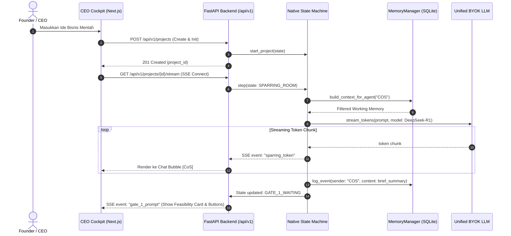
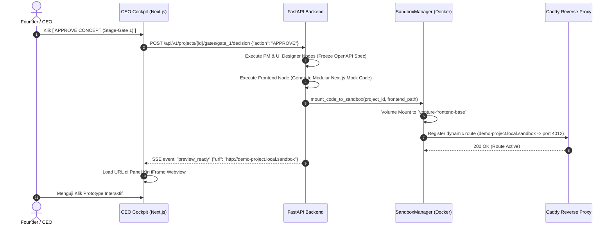
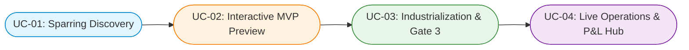
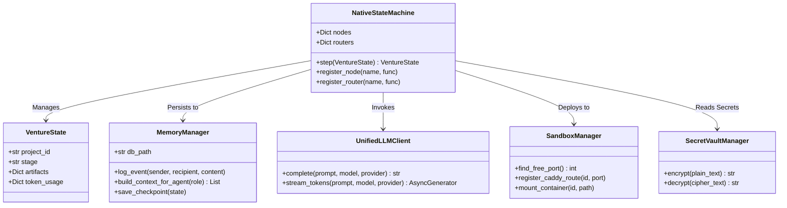
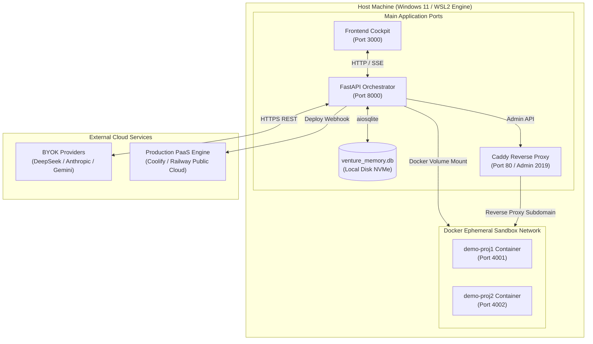

# TECHNICAL DESIGN DOCUMENT (TDD)
## VIRTUAL TECH STARTUP MULTI-AGENT SYSTEM & UNIVERSAL VENTURE INCUBATOR HUB
**Dokumen Desain Rekayasa Teknis & Arsitektur Kelas Rendah (Low-Level Design / LLD)**  
*Versi: 1.0 (Production-Ready / Native-First / Zero-Bloat)*  
*Target: Native Python Asynchronous Engine, SQLite Blackboard & Next.js Cockpit*

---

## 1. PENDAHULUAN & ARSITEKTUR KOMPONEN UTAMA

Dokumen ini mendefinisikan rancangan teknis mendalam mengenai *bagaimana* sistem diimplementasikan di tingkat kode, struktur kelas (*class diagrams*), urutan eksekusi (*sequence diagrams*), skema fisik database, serta penanganan error dan konkurensi.

### 1.1 Diagram Arsitektur Tingkat Komponen

```
┌────────────────────────────────────────────────────────────────────────┐
│                        FRONTEND: CEO COCKPIT (Next.js 14)              │
│  - Zustand State Store      - SSE Event Listener     - iFrame Webview  │
└───────────────────────────────────▲────────────────────────────────────┘
                                    │ HTTP REST & SSE Streaming (/api/v1)
┌───────────────────────────────────▼────────────────────────────────────┐
│                    BACKEND: FASTAPI ORCHESTRATION SERVER               │
│ ┌────────────────────────────────────────────────────────────────────┐ │
│ │ API Router Layer (/api/v1/projects, /sparring, /gates, /vault)      │ │
│ └─────────────────────────────────┬──────────────────────────────────┘ │
│                                   │ Dispatches
│ ┌─────────────────────────────────▼──────────────────────────────────┐ │
│ │             NATIVE PYTHON ASYNC STATE MACHINE ENGINE               │ │
│ │  ┌──────────────┐   ┌───────────────────────┐   ┌────────────────┐ │ │
│ │  │ VentureState │◄──┤  NativeStateMachine   ├──►│ Event Loop &   │ │ │
│ │  │  (Pydantic)  │   │  (Runner & Routers)   │   │ Checkpointing  │ │ │
│ │  └──────────────┘   └───────────┬───────────┘   └────────────────┘ │ │
│ └─────────────────────────────────┼──────────────────────────────────┘ │
│                                   │ Invocations
│    ┌──────────────────────────────┼──────────────────────────────┐     │
│    ▼                              ▼                              ▼     │
│ ┌──────────────────────┐ ┌──────────────────────┐ ┌──────────────────┐ │
│ │ MemoryContextBuilder │ │  UnifiedLLMClient    │ │  SandboxManager  │ │
│ │ (Role-Based Proj.)   │ │  (BYOK Gateway)      │ │  (Docker/Caddy)  │ │
│ └──────────┬───────────┘ └──────────┬───────────┘ └──────────┬───────┘ │
└────────────┼────────────────────────┼────────────────────────┼─────────┘
             ▼                        ▼                        ▼
    ┌─────────────────┐      ┌─────────────────┐      ┌─────────────────┐
    │ SQLite Database │      │ External LLMs   │      │ Pre-Warmed Pool │
    │ (Blackboard Log)│      │ (DeepSeek/Anth) │      │ (Web Sandbox)   │
    └─────────────────┘      └─────────────────┘      └─────────────────┘
```

---

## 2. LOW-LEVEL CLASS DESIGN & INTERFACES

### 2.1 Native State Machine Engine (`backend/app/engine/state_machine.py`)
Mesin orkestrasi dibangun murni menggunakan Python asynchronous tanpa dependensi framework eksternal:

```python
from typing import Callable, Dict, Any, Awaitable, Optional
import asyncio
import json
import logging
from app.engine.state import VentureState
from app.engine.memory import MemoryManager

logger = logging.getLogger("StateMachine")

class NativeStateMachine:
    """
    Core Finite State Machine (FSM) yang mengontrol eksekusi 11 agen
    berdasarkan transisi state deterministik dan checkpointing ke SQLite.
    """
    def __init__(self, memory_mgr: MemoryManager):
        self.nodes: Dict[str, Callable[[VentureState], Awaitable[Dict[str, Any]]]] = {}
        self.routers: Dict[str, Callable[[VentureState], str]] = {}
        self.memory_mgr = memory_mgr

    def register_node(self, state_name: str, handler: Callable[[VentureState], Awaitable[Dict[str, Any]]]):
        """Mendaftarkan handler fungsi asynchronous untuk sebuah state."""
        self.nodes[state_name] = handler

    def register_router(self, state_name: str, router_func: Callable[[VentureState], str]):
        """Mendaftarkan logika percabangan untuk menentukan state berikutnya."""
        self.routers[state_name] = router_func

    async def step(self, state: VentureState) -> VentureState:
        """Mengeksekusi satu langkah node saat ini dan melakukan checkpointing."""
        current_state = state.stage
        if current_state not in self.nodes:
            raise ValueError(f"State '{current_state}' belum terdaftar di state machine.")

        logger.info(f"Executing State Node: [{current_state}] for Project: {state.project_id}")
        
        # 1. Eksekusi Node Agen
        node_handler = self.nodes[current_state]
        updates = await node_handler(state)
        
        # 2. Update State Atribut
        if updates:
            for key, val in updates.items():
                if hasattr(state, key):
                    setattr(state, key, val)
        
        # 3. Tentukan State Berikutnya melalui Router
        if current_state in self.routers:
            next_state = self.routers[current_state](state)
            state.stage = next_state
        
        # 4. Simpan Checkpoint ke SQLite
        await self.memory_mgr.save_checkpoint(state)
        return state
```

### 2.2 Unified BYOK LLM Gateway (`backend/app/gateway/client.py`)
Antarmuka terpadu untuk berkomunikasi dengan berbagai provider LLM menggunakan client `httpx` async murni:

```python
from typing import Dict, Any, List, Optional, AsyncGenerator
import httpx
import os
import json

class UnifiedLLMClient:
    """
    Gateway HTTP Asinkron Universal untuk memanggil model apa pun
    (OpenAI, DeepSeek, Anthropic, Gemini, Ollama) melalui BYOK.
    """
    def __init__(self):
        self.timeout = httpx.Timeout(90.0, connect=10.0)

    async def complete(
        self,
        prompt: str,
        system_prompt: str,
        model: str,
        provider: str,
        temperature: float = 0.7,
        response_format: Optional[Dict[str, Any]] = None
    ) -> str:
        """Panggilan completion non-streaming standar."""
        if provider in ["openai_compatible", "deepseek", "groq", "ollama"]:
            return await self._call_openai_compatible(prompt, system_prompt, model, provider, temperature, response_format)
        elif provider == "anthropic":
            return await self._call_anthropic(prompt, system_prompt, model, temperature)
        elif provider == "gemini":
            return await self._call_gemini(prompt, system_prompt, model, temperature)
        else:
            raise ValueError(f"Provider '{provider}' tidak didukung.")

    async def stream_tokens(
        self,
        prompt: str,
        system_prompt: str,
        model: str,
        provider: str
    ) -> AsyncGenerator[str, None]:
        """Panggilan completion streaming token via SSE."""
        api_key = os.getenv(f"{provider.upper()}_API_KEY", "")
        base_url = os.getenv(f"{provider.upper()}_BASE_URL", "https://api.openai.com/v1")
        
        headers = {"Authorization": f"Bearer {api_key}", "Content-Type": "application/json"}
        payload = {
            "model": model,
            "messages": [
                {"role": "system", "content": system_prompt},
                {"role": "user", "content": prompt}
            ],
            "stream": True
        }
        
        async with httpx.AsyncClient(timeout=self.timeout) as client:
            async with client.stream("POST", f"{base_url}/chat/completions", headers=headers, json=payload) as response:
                async for line in response.aiter_lines():
                    if line.startswith("data: "):
                        data_str = line[6:].strip()
                        if data_str == "[DONE]":
                            break
                        try:
                            chunk = json.loads(data_str)
                            token = chunk["choices"][0]["delta"].get("content", "")
                            if token:
                                yield token
                        except json.JSONDecodeError:
                            continue
```

### 2.3 Memory & Context Projection Manager (`backend/app/engine/memory.py`)
Mengelola penyimpanan persisten dan penyaringan context window per-role:

```python
from typing import List, Dict, Any, Optional
import aiosqlite
import json
from app.engine.state import VentureState

class MemoryManager:
    """Mengelola SQLite Blackboard Event Log dan Context Window Builder."""
    def __init__(self, db_path: str = "./data/venture_memory.db"):
        self.db_path = db_path

    async def log_event(
        self,
        project_id: str,
        stage: str,
        sender_role: str,
        recipient_role: str,
        event_type: str,
        content: str,
        artifact_ref: Optional[str] = None,
        token_cost: float = 0.0
    ):
        """Menyimpan entri event baru ke SQLite blackboard."""
        async with aiosqlite.connect(self.db_path) as db:
            await db.execute(
                """
                INSERT INTO agent_event_logs 
                (project_id, stage, sender_role, recipient_role, event_type, content, artifact_ref, token_cost)
                VALUES (?, ?, ?, ?, ?, ?, ?, ?)
                """,
                (project_id, stage, sender_role, recipient_role, event_type, content, artifact_ref, token_cost)
            )
            await db.commit()

    async def build_context_for_agent(
        self,
        project_id: str,
        target_role: str,
        state: VentureState,
        limit_recent_messages: int = 6
    ) -> List[Dict[str, str]]:
        """
        Merakit prompt context window 3-tier:
        Tier 1: Pinned Contracts
        Tier 2: Role Direct Mentions & Broadcasts
        Tier 3: Sliding Window N percakapan terakhir
        """
        messages = []
        
        # TIER 1: Pinned Contracts (Tergantung Role)
        if target_role == "FRONTEND" and state.openapi_spec:
            messages.append({
                "role": "system",
                "content": f"[PINNED API CONTRACT - STRICT]:\n{json.dumps(state.openapi_spec, indent=2)}"
            })
        elif target_role == "BACKEND" and state.openapi_spec:
            messages.append({
                "role": "system",
                "content": f"[PINNED BACKEND SPECS - STRICT]:\n{json.dumps(state.openapi_spec, indent=2)}"
            })

        # TIER 2 & 3: Filter SQLite History (Direct Mentions & Sliding Window)
        async with aiosqlite.connect(self.db_path) as db:
            db.row_factory = aiosqlite.Row
            cursor = await db.execute(
                """
                SELECT sender_role, content FROM agent_event_logs
                WHERE project_id = ? 
                  AND (recipient_role = ? OR recipient_role = 'BROADCAST' OR sender_role = ?)
                ORDER BY id DESC LIMIT ?
                """,
                (project_id, target_role, target_role, limit_recent_messages)
            )
            rows = await cursor.fetchall()
            
            # Balik urutan agar kronologis dari yang terlama ke terbaru
            for row in reversed(rows):
                role_label = "user" if row["sender_role"] in ["CEO", "COS", "CTO"] else "assistant"
                messages.append({
                    "role": role_label,
                    "content": f"[{row['sender_role']}]: {row['content']}"
                })
                
        return messages
```

### 2.4 Encrypted Secret Vault Manager (`backend/app/core/security.py`)
Menangani enkripsi simetris AES-256-GCM untuk API Key produksi:

```python
import os
import base64
from cryptography.hazmat.primitives.ciphers.aead import AESGCM

class SecretVaultManager:
    """Enkripsi dan dekripsi kredensial produksi menggunakan AES-256-GCM."""
    def __init__(self, master_key_b64: Optional[str] = None):
        key = master_key_b64 or os.getenv("VAULT_MASTER_KEY")
        if not key:
            raise ValueError("VAULT_MASTER_KEY tidak disetel di environment.")
        self.key = base64.b64decode(key)
        self.aesgcm = AESGCM(self.key)

    def encrypt(self, plain_text: str) -> str:
        """Mengenkripsi teks biasa menjadi format [nonce:ciphertext] base64."""
        nonce = os.urandom(12)  # 96-bit nonce standar GCM
        cipher_bytes = self.aesgcm.encrypt(nonce, plain_text.encode('utf-8'), None)
        return base64.b64encode(nonce + cipher_bytes).decode('utf-8')

    def decrypt(self, encrypted_b64: str) -> str:
        """Mendekripsi format [nonce:ciphertext] kembali ke teks asli."""
        raw_data = base64.b64decode(encrypted_b64.encode('utf-8'))
        nonce = raw_data[:12]
        cipher_bytes = raw_data[12:]
        decrypted = self.aesgcm.decrypt(nonce, cipher_bytes, None)
        return decrypted.decode('utf-8')
```

---

## 3. PHYSICAL DATABASE SCHEMA (DDL)

Database dikelola secara lokal menggunakan **SQLite3** dengan WAL (*Write-Ahead Logging*) mode untuk mendukung pembacaan dan penulisan konkuren:

```sql
-- PRAGMA journal_mode = WAL;

-- 1. Tabel Proyek Inkubator
CREATE TABLE IF NOT EXISTS projects (
    id TEXT PRIMARY KEY,
    name TEXT NOT NULL,
    tagline TEXT,
    stage TEXT NOT NULL DEFAULT 'SPARRING_ROOM',
    archetype_id INTEGER NOT NULL DEFAULT 1,
    founder_idea TEXT NOT NULL,
    status TEXT NOT NULL DEFAULT 'ACTIVE',       -- ACTIVE | ARCHIVED | KILLED
    created_at TIMESTAMP DEFAULT CURRENT_TIMESTAMP,
    updated_at TIMESTAMP DEFAULT CURRENT_TIMESTAMP
);

-- 2. Tabel Blackboard Event Log (Memory)
CREATE TABLE IF NOT EXISTS agent_event_logs (
    id INTEGER PRIMARY KEY AUTOINCREMENT,
    project_id TEXT NOT NULL,
    stage TEXT NOT NULL,
    sender_role TEXT NOT NULL,
    recipient_role TEXT NOT NULL,
    event_type TEXT NOT NULL,
    content TEXT NOT NULL,
    artifact_ref TEXT,
    token_cost REAL DEFAULT 0.0,
    created_at TIMESTAMP DEFAULT CURRENT_TIMESTAMP,
    FOREIGN KEY(project_id) REFERENCES projects(id) ON DELETE CASCADE
);

CREATE INDEX IF NOT EXISTS idx_events_project_stage ON agent_event_logs(project_id, stage);
CREATE INDEX IF NOT EXISTS idx_events_recipient ON agent_event_logs(recipient_role);

-- 3. Tabel Checkpoints (State Serialization)
CREATE TABLE IF NOT EXISTS state_checkpoints (
    id INTEGER PRIMARY KEY AUTOINCREMENT,
    project_id TEXT NOT NULL,
    stage TEXT NOT NULL,
    state_blob TEXT NOT NULL,                    -- JSON Serialized VentureState
    step_number INTEGER NOT NULL,
    created_at TIMESTAMP DEFAULT CURRENT_TIMESTAMP,
    FOREIGN KEY(project_id) REFERENCES projects(id) ON DELETE CASCADE
);

-- 4. Tabel Secret Vault (Kredensial Produksi Terenkripsi)
CREATE TABLE IF NOT EXISTS vault_secrets (
    project_id TEXT NOT NULL,
    secret_key_name TEXT NOT NULL,               -- e.g., 'STRIPE_SECRET_KEY', 'PROD_DB_URL'
    encrypted_value TEXT NOT NULL,               -- AES-256 Ciphertext
    created_at TIMESTAMP DEFAULT CURRENT_TIMESTAMP,
    updated_at TIMESTAMP DEFAULT CURRENT_TIMESTAMP,
    PRIMARY KEY(project_id, secret_key_name),
    FOREIGN KEY(project_id) REFERENCES projects(id) ON DELETE CASCADE
);
```

---

## 4. SEQUENCE DIAGRAMS (ALUR EKSEKUSI UTAMA)

### 4.1 Sequence 1: The Executive Sparring Room & Streaming Token (Fase 1)



### 4.2 Sequence 2: Stage-Gate 2 & Pre-Warmed Ephemeral Sandbox (Fase 2)



---

## 5. REVERSE PROXY & EPHEMERAL PORT ALLOCATION LOGIC

Untuk mencegah tabrakan port pada OS Windows saat menjalankan preview kontainer secara paralel, modul `SandboxManager` menggunakan algoritma dynamic port reservation:

```python
import socket
from contextlib import closing
import httpx

class SandboxManager:
    """Mengelola alokasi port dan integrasi dynamic routing ke Caddy."""
    def __init__(self, caddy_api_url: str = "http://localhost:2019"):
        self.caddy_api_url = caddy_api_url
        self.port_range = range(4000, 5000)

    def find_free_port(self) -> int:
        """Mencari port TCP kosong di OS host Windows."""
        for port in self.port_range:
            with closing(socket.socket(socket.AF_INET, socket.SOCK_STREAM)) as sock:
                if sock.connect_ex(('127.0.0.1', port)) != 0:
                    return port
        raise RuntimeError("Semua port sandbox (4000-4999) sedang digunakan.")

    async def register_caddy_route(self, project_id: str, target_port: int):
        """Mendaftarkan subdomain lokal dinamis ke Caddy via REST Admin API."""
        subdomain = f"demo-{project_id}.local.sandbox"
        payload = {
            "@id": f"route_{project_id}",
            "match": [{"host": [subdomain]}],
            "handle": [{
                "handler": "reverse_proxy",
                "upstreams": [{"dial": f"127.0.0.1:{target_port}"}]
            }]
        }
        async with httpx.AsyncClient() as client:
            res = await client.post(f"{self.caddy_api_url}/config/apps/http/servers/srv0/routes", json=payload)
            if res.status_code not in [200, 201]:
                raise RuntimeError(f"Gagal meregistrasi Caddy route: {res.text}")
```

---

## 6. ERROR HANDLING, RETRY & CIRCUIT BREAKERS

| Skenario Kegagalan | Tindakan Otomatis Sistem |
| :--- | :--- |
| **Model LLM Rate Limit (429) / Downtime (500)** | Mengaktifkan **Fallback Provider Cascade** otomatis: `DeepSeek` $\to$ `Anthropic` $\to$ `OpenAI` $\to$ `Gemini`. |
| **Syntactic JSON Error / Schema Mismatch** | Mengirimkan pesan validasi error kembali ke LLM agen dengan instruksi perbaikan otomatis (*auto-correction loop*, batas 2x). |
| **Loop Koding Tak Berujung (Infinite Repair)** | **Circuit Breaker** menghentikan eksekusi jika perbaikan berulang $\ge 5$ kali, lalu mengirimkan notifikasi *Human Intervention Required* ke CEO Cockpit. |
| **Subprocess Execution Timeout** | Jika eksekusi task melebihi 90 detik, proses dibatalkan paksa (`asyncio.wait_for` timeout exception) dan status ditandai `TIMED_OUT`. |

---

## 7. KRUCHTEN 4+1 ARCHITECTURAL VIEW MODEL

Sebagai standar formal dalam arsitektur perangkat lunak enterprise, bab ini mengkonsolidasikan seluruh cetak biru teknis sistem ke dalam 5 sudut pandang Kruchten (1995):

```
                      ┌─────────────────────────┐
                      │    1. LOGICAL VIEW      │
                      │  (Class, State & Schemas│
                      └────────────┬────────────┘
                                   │
┌─────────────────────────┐        ▼        ┌─────────────────────────┐
│     2. PROCESS VIEW     │   ┌─────────┐   │  3. DEVELOPMENT VIEW    │
│  (Asyncio, SSE, WAL)    ├──►│SCENARIOS├──►│(Layering, Packages, Tree│
└─────────────────────────┘   │  (+1)   │   └─────────────────────────┘
                               └───┬─────┘
                                   │
                      ┌────────────▼────────────┐
                      │    4. PHYSICAL VIEW     │
                      │(Windows, Docker, Caddy) │
                      └─────────────────────────┘
```

### 7.1 The +1 Scenarios (Use Case View - Sudut Pandang Pengguna)
*Use Case View* berfungsi sebagai perekat yang memvalidasi keempat sudut pandang lainnya melalui perjalanan nyata pengguna (Founder & CEO):



1. **UC-01 (Sparring Room):** Founder menginput ide mentah $\to$ CoS & CTO berkolaborasi menganalisis kelayakan $\to$ Gate 1 approval.
2. **UC-02 (Interactive Demo Day):** PM mengunci OpenAPI spec $\to$ Frontend Agent membuat Next.js mock $\to$ Sandbox menyajikan iFrame webview $\to$ Gate 2 decision.
3. **UC-03 (Production Hardening):** Backend Agent menulis API & migrasi database $\to$ QA menguji keamanan OWASP $\to$ Founder memasukkan API Key produksi ke Secret Vault $\to$ Gate 3 approval.
4. **UC-04 (Live Venture Operations):** DevSecOps memicu build kontainer $\to$ PaaS API mendeploy ke domain publik $\to$ Telemetry mencatat laba bersih riil.

---

### 7.2 Logical View (Sudut Pandang Logika & Struktur Kelas)
Menjelaskan dekomposisi fungsional sistem ke dalam entitas objek dan tanggung jawabnya:



---

### 7.3 Process View (Sudut Pandang Konkurensi & Aliran Proses)
Menjelaskan bagaimana sistem menangani thread, proses non-blocking, dan konkurensi data:

1. **Single-Threaded Asynchronous Event Loop (`asyncio`):**  
   FastAPI dan Native State Machine berjalan pada event loop non-blocking. I/O berat (pemanggilan REST LLM via `httpx` dan query database via `aiosqlite`) dieksekusi secara asinkron tanpa memblokir thread utama.
2. **Real-time Event Streaming Pipeline (SSE):**  
   Generator asinkron (`AsyncGenerator`) mentransfer token kata demi kata langsung dari soket HTTPS penyedia LLM menuju browser pengguna dalam hitungan milidetik.
3. **Database Concurrency Control (SQLite WAL Mode):**  
   Mekanisme *Write-Ahead Logging* memungkinkan pembacaan data (misal: query context builder dan dashboard telemetry) berjalan paralel tanpa terhalang operasi penulisan (*locks*).
4. **Non-blocking Subprocess Isolation:**  
   Eksekusi build kontainer Docker dan runner sandbox dipisahkan ke dalam subprocess asinkron (`asyncio.create_subprocess_exec`) dengan timeout tegas 90 detik.

---

### 7.4 Development / Implementation View (Sudut Pandang Modul & Layering)
Menjelaskan organisasi paket perangkat lunak menggunakan arsitektur modular berlapis (*Layered Architecture*):

```
┌────────────────────────────────────────────────────────────────────────┐
│ 1. PRESENTATION LAYER (Next.js 14 Cockpit Dashboard)                  │
│    - Pages (App Router), UI Components, Zustand State, SSE Hooks       │
├────────────────────────────────────────────────────────────────────────┤
│ 2. API & INTERFACE LAYER (FastAPI Routers)                             │
│    - /api/v1/projects, /sparring, /gates, /telemetry, /vault           │
├────────────────────────────────────────────────────────────────────────┤
│ 3. DOMAIN & ORCHESTRATION LAYER (Native Engine)                       │
│    - NativeStateMachine, VentureState Models, 11 Agent Nodes           │
├────────────────────────────────────────────────────────────────────────┤
│ 4. INTEGRATION & ADAPTER LAYER (BYOK & Bridges)                        │
│    - UnifiedLLMClient (OpenAI, Anthropic, Gemini, Ollama)              │
│    - SandboxManager (Docker, Caddy Admin API)                          │
│    - PaaS Deployment Client (Coolify/Railway API)                      │
├────────────────────────────────────────────────────────────────────────┤
│ 5. DATA & PERSISTENCE LAYER                                            │
│    - MemoryManager (SQLite3 aiosqlite), SecretVaultManager (AES-256)   │
└────────────────────────────────────────────────────────────────────────┘
```

---

### 7.5 Physical / Deployment View (Sudut Pandang Infrastruktur Fisik & Jaringan)
Menjelaskan topologi perangkat keras, kontainerisasi, dan pemetaan jaringan:



* **Jaringan Lokal Sandbox:** Reverse Proxy Caddy mendengarkan port 80 dan merutekan traffic subdomain `demo-<id>.local.sandbox` secara langsung ke port kontainer ephemeral yang terisolasi (`4000-4999`).
* **Jaringan Produksi Publik:** Kontainer rilis akhir dideploy keluar dari mesin host lokal menuju penyedia cloud PaaS (Coolify VPS atau Railway) dengan domain publik resmi dan sertifikat SSL Let's Encrypt terotomatisasi.

