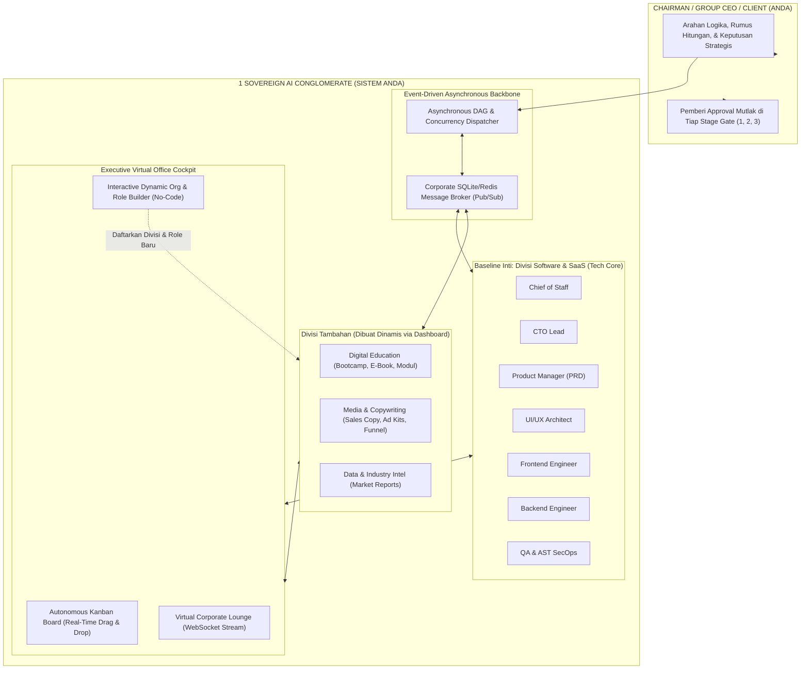

# Cetak Biru Pengembangan Masa Depan: Autonomous AI Virtual Company (v2.0)
**Proyek:** Virtual Tech Startup Multi-Agent System & Universal Venture Incubator Hub  
**Arsitektur Target:** *Event-Driven Asynchronous Sovereign Corporate OS (Multi-Product AI Conglomerate)*  
**Dokumen Referensi:** [audit_final_v1.md](file:///d:/my%20project/VIRTUAL%20TECH%20STARTUP%20MULTI-AGENT%20SYSTEM/audit_final_v1.md)  
**Tanggal Pemutakhiran:** 2 Oktober 2026  
**Status Dokumen:** **APPROVED ARCHITECTURAL BLUEPRINT & V2.0 IMMEDIATE EXECUTION PLAN**

---

## 1. Pendahuluan & Filosofi "Samsung Conglomerate" (Universal AI Enterprise)

Berdasarkan evaluasi akhir di [audit_final_v1.md](file:///d:/my%20project/VIRTUAL%20TECH%20STARTUP%20MULTI-AGENT%20SYSTEM/audit_final_v1.md), sistem ini **bukanlah** platform untuk membuat ribuan perusahaan baru, dan **bukan pula** sekadar chatbot "asisten / tangan kanan" pasif.

Sistem ini adalah **1 PERUSAHAAN VIRTUAL UTUH (A Real Sovereign AI Conglomerate)** milik Anda sendiri—mengadopsi model konglomerasi raksasa seperti **Samsung Group**:
- **Satu Entitas Induk (*Single Enterprise Holding*):** Memiliki berbagai divisi bisnis spesialis di bawah satu naungan perusahaan.
- **Chairman / Group CEO / Prime Client (Anda):** Anda memegang kendali tertinggi: memberikan arahan strategis, rumus logika, parameter hitungan, dan validasi persetujuan mutlak (*Stage-Gate Approver*).
- **Perusahaan Bekerja Secara Nyata (*Real Autonomous Execution*):** Setiap divisi menghasilkan produk komersial yang nyata, teruji, dan siap menghasilkan uang (*ready to monetize*).
- **Solusi atas Keterbatasan Manusiawi:** Sebagai manusia, sangat sulit untuk menjadi "super-generalist" yang harus menguasai koding, hitungan logika, sekaligus memiliki daya kreatif puitis, empati desain, dan psikologi penjualan. Perusahaan virtual ini melengkapi kelemahan tersebut: Anda mengendalikan logika & arsitektur, sementara divisi kreatif, edukasi, dan pemasaran AI menyediakan rasa, seni, dan daya pikat komersialnya.



---

## 2. Prinsip Rekayasa v2.0: Fokus Tech Baseline & Zero Hardcode

> [!IMPORTANT]
> **STRATEGI EKSEKUSI PENGEMBANGAN v2.0 (PRAGMATIC & DISCIPLINED ENGINEERING):**
> 1. **Saat developing v2.0, kita TIDAK PERLU me-hardcode divisi-divisi non-tech** (seperti Edukasi, Copywriting, Marketing) ke dalam file kode backend Python (`nodes/*.py`).
> 2. **Baseline pengembangan dan pengujian tetap 100% menggunakan struktur Tech Core yang sudah ada** (CoS, CTO, PRD, UI/UX, Frontend, Backend, QA).
> 3. **Alasan Teknis:**
>    - **Kerapian & Keterukuran Pengujian (*Controlled Benchmark*):** Menjaga test suite 68/68 tetap hijau, mempermudah verifikasi worker asinkron, dan memastikan tidak ada regresi pada sandbox.
>    - **Mencegah Kode Kembung (*Anti-Bloatware*):** Seluruh divisi baru, role baru, persona, workflow, dan departemen kustom **akan dibuat secara dinamis langsung dari Dashboard Web UI (*Virtual Org Studio*)** tanpa menyentuh kode Python sama sekali!

---

## 3. Perlindungan Sakral Alur Tech Company & Kemandirian Produk

### A. Alur Tech Company Tetap Menjadi "Standar Emas" (Tidak Dibuang / Tidak Diubah)
Alur industri software engineering yang telah kita bangun secara kokoh dari Sprint 1 hingga Sprint 6 **TIDAK AKAN PERNAH DIBUANG ATAU DIUBAH**:

```
[ IDEASI / SPARRING ] 
        │
        ▼
[ GATE 1: PRD & ARSITEKTUR ] ── (Persetujuan Chairman)
        │
        ▼
[ MOCK PROTOTYPING (MVP) ] ──── (Dual-Engine Live Sandbox)
        │
        ▼
[ GATE 2: APPROVAL MVP ] ────── (Persetujuan Chairman)
        │
        ▼
[ PRODUCTION HARDENING ] ────── (AST OWASP Scanner + Scaffolding Mandiri + Security Vault)
        │
        ▼
[ GATE 3: FINAL GO-LIVE ] ───── (Persetujuan Chairman)
        │
        ▼
[ LIVE DEPLOY & MONETIZE ]
```
Setiap produk software (Web App, SaaS, REST API) yang diperintahkan oleh Chairman **wajib** melalui tahapan disiplin ini guna menjamin zero-bug, zero-security vulnerability, dan kelayakan produksi komersial.

---

### B. Tiap Divisi Mampu Menghasilkan Produknya Sendiri (*Independent Product Creation*)
Layaknya Samsung yang memproduksi chipset secara mandiri, smartphone secara mandiri, dan kapal tanker secara mandiri, **tiap divisi di perusahaan Anda (baik Tech maupun divisi yang Anda buat di Dashboard) memiliki lisensi penuh untuk memproduksi aset digitalnya sendiri**:

| Divisi Perusahaan | Jenis Produk Mandiri yang Dihasilkan | Siklus Kerja / Workflow Produksi Divisi | Status Implementasi |
| :--- | :--- | :--- | :--- |
| **Divisi Software & SaaS (Tech Core)** | Aplikasi SaaS, Web Platform, API Backend, Tools Otomasi. | `Ide -> PRD -> MVP Sandbox -> AST Scan -> Hardening -> Scaffolding Deploy`. | **Aktif 100% (Built-in)** |
| **Divisi Digital Education** | Kursus Online Lengkap (*Bootcamp*), Panduan E-Book Praktis, Bank Soal & Kuis. | `Riset Topik -> Desain Silabus -> Penulisan Modul -> Pembuatan Soal -> Review Pedagogi -> Packaging`. | *Dibuat Dinamis via Dashboard* |
| **Divisi Media & Copywriting** | Template Copywriting (Swipe Files), Newsletter Berbayar, Naskah Iklan Meta/TikTok. | `Analisis Target Audiens -> Naskah Hook -> Copy Body -> CTA Formula -> Review Persuasi`. | *Dibuat Dinamis via Dashboard* |
| **Divisi Riset & Data Intel** | Laporan Riset Tren Pasar B2B, Pemetaan Kompetitor, Dataset Industri. | `Web Search/Scraping -> Ekstraksi Data -> Analisis SWOT -> Penyusunan Laporan Eksekutif`. | *Dibuat Dinamis via Dashboard* |

---

### C. Sinergi Lintas Divisi untuk Monetisasi Produk (*Cross-Divisional Synergy*)
Selain memproduksi aset sendiri, divisi-divisi di perusahaan Anda dapat saling bekerja sama secara otomatis:
1. **Divisi Tech** menyelesaikan aplikasi SaaS akuntansi UMKM hingga lolos uji AST OWASP dan siap deploy.
2. Begitu aplikasi selesai, sistem memicu tiket ke **Divisi Copywriting & Marketing** (yang Anda racik di Dashboard) untuk membuat:
   - Halaman penawaran (*landing page copy*) dengan bahasa persuasif dan menyentuh emosi pemilik toko.
   - Skema penetapan harga (*Pricing tiers: Free vs Pro*).
   - Naskah email onboarding dan kampanye promosi media sosial.
3. **Divisi Edukasi** membuat modul panduan praktis dan video tutorial pemakaian aplikasi.
4. **Hasil Akhir:** Produk yang siap meluncur ke publik bukan sekadar kodingan mentah, melainkan **sebuah bisnis komersial utuh yang langsung siap menghasilkan uang (*production-ready & monetization-ready*)**.

---

## 4. Eksekusi 100% Asynchronous (Non-Blocking Concurrency)

Dalam arsitektur korporat v2.0, **tidak ada satu agen atau divisi yang memblokir jalannya sistem**, kecuali jika ada dependensi tiket tugas yang eksplisit (*DAG Dependencies*).

```mermaid
gantt
    title Eksekusi Asinkron Lintas Agen & Divisi Perusahaan
    dateFormat  X
    axisFormat %s detik

    section Divisi Software (Tech Core)
    Kompilasi Backend & Sandbox           :active, tech1, 0, 10
    Pemindaian AST OWASP Scanner          :crit, tech2, 10, 15
    Scaffolding & Scaffolding Assembly    :tech3, 15, 25

    section Divisi Edukasi (Custom via UI)
    Riset Kurikulum & Studi Kasus          :active, edu1, 0, 8
    Penulisan Naskah Modul Bab 1-3         :edu2, 8, 18
    Pembuatan Kuis Interaktif              :edu3, 18, 25

    section Divisi Marketing (Custom via UI)
    Analisis Pain-Point Pasar & Hook      :active, mkt1, 0, 6
    Penyusunan Landing Page Copy           :mkt2, 6, 14
    Perancangan Skema Monetisasi           :mkt3, 14, 25
```



### Mekanisme Teknis Asynchronous v2.0:
1. **Asyncio Worker Pool:** Setiap agen (baik agen Tech maupun agen kustom yang dibuat di UI) dijalankan di background worker asinkron non-blocking (`asyncio.create_task`).
2. **Directed Acyclic Graph (DAG) Task Orchestrator:**  
   Frontend dan Backend dapat berjalan secara paralel (*concurrent execution*). Jika agen Copywriter membutuhkan skema endpoint dari Backend, tiket Copywriter berada dalam status `WAITING_DEPENDENCY`, sementara tugas riset lainnya tetap berjalan bebas tanpa jeda.
3. **Event-Driven Pub/Sub Bus (`corporate_event_bus`):**  
   Pesan dan event ditransmisikan secara instan via SQLite Blackboard / in-memory event emitter, diteruskan ke Next.js Dashboard menggunakan streaming WebSocket.

---

## 5. Solusi Pemecahan Keterbatasan Sistem Saat Ini

Menjawab seluruh temuan obyektif pada [audit_final_v1.md](file:///d:/my%20project/VIRTUAL%20TECH%20STARTUP%20MULTI-AGENT%20SYSTEM/audit_final_v1.md):

### A. Keterbatasan 1: Alur Masih Berupa Directed Sequential Pipeline
- **Solusi:** Transformasi total ke **Event-Driven Task Dispatcher**. Siklus sekuensial tunggal digantikan dengan antrean tiket otonom di mana multi-agen mengeksekusi tugas secara paralel sesuai kapabilitas role-nya masing-masing.

### B. Keterbatasan 2: Ketiadaan Long-Term Cross-Venture Memory (Organizational Wisdom)
- **Solusi: Corporate Wisdom Vector Engine (sqlite-vss / ChromaDB):**  
  Setiap solusi atas bug, perbaikan arsitektur, atau formula copywriting sukses diindeks ke dalam basis data vektor lokal. Agen di proyek-proyek masa depan melakukan *semantic retrieval* sebelum bekerja, sehingga pengalaman korporat terus bertambah cerdas dari waktu ke waktu.

### C. Keterbatasan 3: PaaS Deployer Masih Berupa Simulator (Mock)
- **Solusi: Coolify / Railway Direct Driver:**  
  Integrasi webhook produksi yang mengunggah `Dockerfile` dan kode jadi langsung ke server Coolify (self-hosted PaaS) milik Founder untuk live hosting publik dengan domain kustom dan sertifikat SSL otomatis.

---

## 6. Sandboxing Generasi Baru (Next-Gen Isolation Runtime)

Untuk mendukung eksekusi multi-produk yang aman, fleksibel, dan interaktif:

```
+-----------------------------------------------------------------------------------+
|                           NEXT-GEN SANDBOX ARCHITECTURE                           |
+-----------------------------------------------------------------------------------+
|  [ LAYER 1: BROWSER WASM (WebContainers) ]                                       |
|  - Eksekusi Node.js / Next.js langsung di thread browser WebAssembly              |
|  - Latensi 0 ms, nol beban CPU/RAM pada server backend                            |
+-----------------------------------------------------------------------------------+
|  [ LAYER 2: ISOLATED MICRO-CONTAINERS (gVisor / Firecracker) ]                    |
|  - Eksekusi backend Python/FastAPI dalam kernel terisolasi                        |
|  - Egress Network Filtering: Mencegah kode agen mengakses jaringan lokal user    |
|  - Resource Quota Capping: Max 512 MB RAM, 1 vCPU per venture sandbox             |
+-----------------------------------------------------------------------------------+
|  [ LAYER 3: INTERACTIVE PTY TERMINAL (xterm.js WebSockets) ]                      |
|  - Terminal interaktif live di Web Dashboard                                      |
|  - Founder & Agen dapat menjalankan 'npm run dev', 'pip install', atau test CLI   |
+-----------------------------------------------------------------------------------+
|  [ LAYER 4: COPY-ON-WRITE (CoW) FILESYSTEM SNAPSHOTTING ]                         |
|  - Snapshot instan direktori proyek sebelum agen melakukan modifikasi besar       |
|  - Rollback 1-klik jika terjadi kerusakan kode atau breaking change fatal         |
+-----------------------------------------------------------------------------------+
```

---

## 7. Penambahan Divisi dan Role secara Interaktif melalui Dashboard

Inilah inti dari fleksibilitas tanpa batas perusahaan Anda: **Founder dapat memperluas struktur organisasi perusahaannya secara instan langsung dari Web UI tanpa menyentuh file kode Python**:

### A. Fitur Antarmuka "Virtual Org Studio":
1. **Visual Org Chart Canvas:** Pohon visual struktur konglomerasi (menggunakan graf node interaktif) yang menunjukkan divisi dan garis koordinasi.
2. **Modal "Tambah Divisi Baru":**
   - Nama Divisi (cth: *"AI Red-Teaming & Security"*, *"Digital Education"*, *"Growth Copywriting"*).
   - Aksen warna liquid chrome dan ikon divisi.
   - Mandat bisnis divisi.
3. **Modal "Tambah Role / Karyawan AI Baru":**
   - Nama Role & Persona System Prompt.
   - Pilihan LLM Model (OpenRouter Free, Claude 3.5, DeepSeek R1, GPT-4o, Ollama lokal).
   - Hak Akses Tools (`File System`, `AST Scanner`, `Web Search`, `Terminal PTY`).
   - Batas Anggaran Token per Task (*CFO Budget Guardrail*).
4. **Hot-Reloading Registry:** Begitu disimpan, agen langsung terdaftar di database SQLite dan siap menerima delegasi tiket kerja di Kanban.

---

## 8. Desain Skema Basis Data Relasional v2.0 (DDL Schema)

Skema database SQLite baru untuk mendukung konglomerasi multi-divisi otonom:

```sql
-- ============================================================================
-- 1. TABEL DIVISI KORPORAT DINAMIS (DYNAMIC CORPORATE DIVISIONS)
-- ============================================================================
CREATE TABLE IF NOT EXISTS corporate_divisions (
    id TEXT PRIMARY KEY,
    name TEXT NOT NULL UNIQUE,
    slug TEXT NOT NULL UNIQUE,
    description TEXT,
    accent_color TEXT DEFAULT '#cbd5e1',
    icon_name TEXT DEFAULT 'FolderTree',
    is_system_default BOOLEAN DEFAULT 0,
    created_at TIMESTAMP DEFAULT CURRENT_TIMESTAMP,
    updated_at TIMESTAMP DEFAULT CURRENT_TIMESTAMP
);

-- Divisi Default Bawaan Sistem (Tech Core Baseline)
INSERT OR IGNORE INTO corporate_divisions (id, name, slug, description, accent_color, is_system_default)
VALUES 
    ('div_exec', 'Executive Suite', 'executive', 'Koordinasi strategis, anggaran CFO, & approvals', '#ffffff', 1),
    ('div_eng', 'Software & SaaS Division', 'engineering', 'Rekayasa perangkat lunak, arsitektur, coding, & QA', '#3b82f6', 1);

-- ============================================================================
-- 2. TABEL ROLE / KARYAWAN AI DINAMIS (DYNAMIC CORPORATE ROLES)
-- ============================================================================
CREATE TABLE IF NOT EXISTS corporate_roles (
    id TEXT PRIMARY KEY,
    division_id TEXT NOT NULL,
    name TEXT NOT NULL,
    slug TEXT NOT NULL UNIQUE,
    system_prompt_template TEXT NOT NULL,
    model_provider TEXT NOT NULL DEFAULT 'openrouter',
    model_name TEXT NOT NULL DEFAULT 'deepseek/deepseek-r1:free',
    temperature REAL DEFAULT 0.2,
    tool_permissions TEXT NOT NULL DEFAULT '["read_file", "write_file", "ast_scan"]',
    token_budget_per_task INTEGER DEFAULT 8000,
    is_active BOOLEAN DEFAULT 1,
    is_system_default BOOLEAN DEFAULT 0,
    created_at TIMESTAMP DEFAULT CURRENT_TIMESTAMP,
    updated_at TIMESTAMP DEFAULT CURRENT_TIMESTAMP,
    FOREIGN KEY(division_id) REFERENCES corporate_divisions(id) ON DELETE CASCADE
);

-- Seed Role Bawaan Sistem (Tech Core Baseline)
INSERT OR IGNORE INTO corporate_roles (id, division_id, name, slug, system_prompt_template, is_system_default)
VALUES
    ('role_cos', 'div_exec', 'Chief of Staff', 'cos', 'Orkestrasi ide dan strategi', 1),
    ('role_cto', 'div_eng', 'Chief Technology Officer', 'cto', 'Arsitektur teknis dan arketipe', 1),
    ('role_fe', 'div_eng', 'Frontend Engineer', 'frontend', 'Implementasi antarmuka Next.js', 1),
    ('role_be', 'div_eng', 'Backend Engineer', 'backend', 'Implementasi API FastAPI & database', 1),
    ('role_qa', 'div_eng', 'QA Engineer', 'qa', 'Audit keamanan AST & unit test', 1);

-- ============================================================================
-- 3. TABEL PAPAN TIKET OTONOM (VIRTUAL KANBAN TICKETS)
-- ============================================================================
CREATE TABLE IF NOT EXISTS corporate_tickets (
    id TEXT PRIMARY KEY,
    project_id TEXT NOT NULL,
    division_id TEXT NOT NULL,
    assigned_role_id TEXT,
    title TEXT NOT NULL,
    description TEXT NOT NULL,
    product_line TEXT NOT NULL DEFAULT 'SOFTWARE', -- 'SOFTWARE', 'EDUCATION', 'COPYWRITING', 'RESEARCH'
    priority TEXT NOT NULL DEFAULT 'MEDIUM',       -- 'LOW', 'MEDIUM', 'HIGH', 'CRITICAL'
    status TEXT NOT NULL DEFAULT 'BACKLOG',         -- 'BACKLOG', 'TODO', 'IN_PROGRESS', 'REVIEW', 'DONE'
    artifact_refs TEXT,                            -- JSON list: path file yang dihasilkan
    dependencies TEXT,                             -- JSON list ticket_id yang harus selesai lebih dulu
    parent_ticket_id TEXT,
    created_at TIMESTAMP DEFAULT CURRENT_TIMESTAMP,
    updated_at TIMESTAMP DEFAULT CURRENT_TIMESTAMP,
    FOREIGN KEY(project_id) REFERENCES projects(id) ON DELETE CASCADE,
    FOREIGN KEY(division_id) REFERENCES corporate_divisions(id) ON DELETE CASCADE,
    FOREIGN KEY(assigned_role_id) REFERENCES corporate_roles(id) ON DELETE SET NULL
);

CREATE INDEX IF NOT EXISTS idx_tickets_project_status ON corporate_tickets(project_id, status);

-- ============================================================================
-- 4. TABEL EVENT BUS ASINKRON (INTER-AGENT MESSAGE BUS)
-- ============================================================================
CREATE TABLE IF NOT EXISTS corporate_messages (
    id INTEGER PRIMARY KEY AUTOINCREMENT,
    project_id TEXT NOT NULL,
    channel_type TEXT NOT NULL DEFAULT 'LOUNGE', -- 'LOUNGE', 'P2P_DISPUTE', 'REVIEW_FEEDBACK'
    sender_role_id TEXT NOT NULL,
    recipient_role_id TEXT,                      -- NULL = Broadcast ke seluruh divisi
    ticket_id TEXT,
    event_type TEXT NOT NULL,                    -- 'MESSAGE', 'TASK_COMPLETED', 'SCHEMA_CHANGE', 'TEST_ALERT'
    content TEXT NOT NULL,
    token_cost REAL DEFAULT 0.0,
    created_at TIMESTAMP DEFAULT CURRENT_TIMESTAMP,
    FOREIGN KEY(project_id) REFERENCES projects(id) ON DELETE CASCADE
);

CREATE INDEX IF NOT EXISTS idx_messages_project_time ON corporate_messages(project_id, created_at DESC);
```

---

## 9. Rencana Eksekusi Bertahap v2.0 (Immediate Execution Roadmap)

Berikut adalah urutan sprint eksekusi konkret yang siap langsung kita jalankan:

```
+-----------------------------------------------------------------------------------+
|                           V2.0 EXECUTION TIMELINE                                 |
+-----------------------------------------------------------------------------------+
|  [ SPRINT 2.1: DYNAMIC CORPORATE SCHEMA & CRUD REGISTRY ]                         |
|  - Migrasi DDL tabel corporate_* di SQLite WAL                                    |
|  - Seeding Tech Core Baseline default (CoS, CTO, FE, BE, QA)                      |
|  - REST API CRUD (/api/v1/corporate/divisions & /roles) di FastAPI                |
|  - Validasi test suite: 100% green pass                                           |
+-----------------------------------------------------------------------------------+
|  [ SPRINT 2.2: ASYNCHRONOUS ACTOR EVENT BUS & TASK DISPATCHER ]                   |
|  - Refactor loop sekuensial menjadi asyncio worker pool                           |
|  - Implementasi eksekusi paralel (Frontend & Backend berjalan bersamaan)          |
|  - Mekanisme event pub/sub SQLite bus & task dependencies (DAG)                   |
+-----------------------------------------------------------------------------------+
|  [ SPRINT 2.3: NEXT.JS INTERACTIVE ORG STUDIO (DASHBOARD) ]                       |
|  - Antarmuka visual Org Chart di Dashboard Next.js                                |
|  - Modal interaktif "Tambah Divisi" & "Tambah Karyawan AI"                        |
|  - Form konfigurasi system prompt, model selection, dan hak akses tools           |
+-----------------------------------------------------------------------------------+
|  [ SPRINT 2.4: AUTONOMOUS KANBAN BOARD & LIVE WEBSOCKET LOUNGE ]                  |
|  - Papan Kanban adaptif 5 kolom (Backlog -> Todo -> In Progress -> Review -> Done)|
|  - Perpindahan kartu tiket otomatis saat worker menyelesaikan tugas               |
|  - Streaming obrolan Lounge antar-agen secara real-time via WebSocket             |
+-----------------------------------------------------------------------------------+
|  [ SPRINT 2.5: NEXT-GEN SANDBOX & INTERACTIVE PTY TERMINAL ]                      |
|  - Integrasi xterm.js terminal di webview (real-time build logs & CLI)            |
|  - Filesystem snapshotting (rollback 1-klik sebelum perubahan besar)              |
|  - Verifikasi akhir end-to-end regression test suite                              |
+-----------------------------------------------------------------------------------+
|  [ SPRINT 2.6: DYNAMIC WORKFLOW PIPELINE & EXECUTIVE GOVERNANCE HUB ]             |
|  - Dukungan alur sekuensial iteratif / perulangan (contoh: A -> B -> C -> A -> C)  |
|  - Drag-and-Drop visual canvas interaktif pada Workflow Pipeline Builder          |
|  - CEO / Human-in-the-Loop First-Class Pipeline Node (No-Code Approval & Sparring) |
|  - Hybrid Decision Space: Agen berotonomi mikro (Proceed, Consult, Escalate)      |
|  - Anti-Infinite Loop Circuit Breaker: Auto-freeze setelah 3x perdebatan tanpa kode|
|  - C-Level Direct Escalation: Laporan strategis CTO/CoS ke meja CEO (2-Opsi Klik)|
+-----------------------------------------------------------------------------------+
```

---

## 10. Cetak Biru Fitur Sprint 2.6: Dynamic Pipeline & Executive Governance Hub

### 10.1 Konsep Alur Iteratif (Multi-Occurrence Roles)
Di dunia nyata, alur pengembangan sering kali membutuhkan iterasi ulang ke peran sebelumnya:
- **Contoh Kasus:** `PM` merumuskan PRD ➔ `UI/UX` membuat desain ➔ `Frontend` membuat prototipe ➔ Kembali ke `PM` untuk evaluasi spesifikasi baru ➔ Lanjut ke `Backend` & `QA`.
- **Perubahan Arsitektur Data:**
  - Sebelumnya: 1 Peran hanya memiliki 1 `order_index` statis di tabel `corporate_roles`.
  - Baru: Entitas sekuens tahapan independen (`stage_index`, `branch_id`, `role_id`), sehingga peran yang sama dapat dipanggil berulang kali di tahapan berlainan tanpa konflik basis data.

### 10.2 Antarmuka Visual Drag-and-Drop (DND)
- Pengguna dapat menarik kartu peran langsung ke urutan yang diinginkan.
- Palet "Daftar Peran Tersedia" di sisi samping atau bawah yang bisa ditarik ke dalam linimasa tahapan.
- Animasi transisi halus saat kartu berpindah posisi, dengan tombol hapus/duplikasi instan per tahapan.

### 10.3 CEO / Human-in-the-Loop Sebagai First-Class Pipeline Node (No-Code Governance)
Ide terobosan untuk mengubah Stage-Gate yang awalnya hardcoded di Python menjadi **kartu node independen** yang dapat ditarik dan disisipkan di mana saja pada linimasa visual:
- **Kartu Khusus:** `CEO Human Gate & Sparring Node` (Aksen Platinum Gold / Crown).
- **Tipe Interaksi Dinamis:**
  1. `APPROVAL_GATE`: Menjeda eksekusi (*pause*) dan menunggu keputusan Founder (Approve / Revise / Reject).
  2. `STRATEGIC_MEETING`: Otomatis memicu panggilan rapat di Corporate Lounge untuk diskusi dua arah dengan agen terkait sebelum masuk ke fase berikutnya.
  3. `DIRECTION_INPUT`: Meminta instruksi/parameter spesifik dari Founder (misal: budget cap, target audience, atau preferensi stack).
- **Fleksibilitas Tanpa Koding (*Zero Code Customization*):**
  - Untuk alur cepat (Fast Track): Founder bisa menyusun pipeline tanpa gate CEO (100% otonom).
  - Untuk alur presisi tinggi (Strict Governance): Founder bisa meletakkan node CEO di setiap pergantian divisi (misal: `CoS ➔ CEO Review ➔ CTO ➔ PM ➔ CEO Meeting ➔ Frontend ➔ CEO Demo ➔ Backend ➔ QA`).

### 10.4 Hybrid Action Space & Otonomi Mikro Agen
Setiap agen yang sedang aktif tidak hanya menulis kode secara buta, tetapi memiliki *Structured JSON Decision Space*:
- `PROCEED_NEXT_STAGE`: Tugas tuntas 100%, memajukan pipeline secara otomatis.
- `CONSULT_ROLE`: Mengajukan pertanyaan/klarifikasi spesifikasi ke peran terkait (misal: Backend tanya ke PM).
- `ESCALATE_TO_C_LEVEL`: Menyerahkan masalah arsitektural ke CTO atau masalah bisnis ke CoS.
- `REQUEST_REWORK`: Mengembalikan tiket ke peran sebelumnya jika ditemukan inkonsistensi kontrak data.

### 10.5 Anti-Infinite Loop Circuit Breaker (Rem Darurat Otomatis)
Mencegah agen terjebak dalam perdebatan tanpa ujung yang membakar token inferensi:
- **Aturan Pembekuan:** Jika dua agen saling melempar klarifikasi lebih dari **3 putaran** pada satu tiket yang sama tanpa kemajuan kode baru:
  1. Sistem otomatis membekukan (*freeze*) proses eksekusi.
  2. Status tiket diubah menjadi `BLOCKED_LOOP_DETECTED`.
  3. Mengirimkan notifikasi darurat ke CEO Dashboard & bot Telegram Founder.
- **Hak Veto CEO (Manual Override):** CEO dapat melakukan intervensi langsung lewat tombol *Bypass / Force Proceed*, menengahi diskusi di Lounge, atau me-reroute alur kerja.

### 10.6 C-Level Direct Escalation (Pelaporan Khusus Direksi ke CEO)
Ketika terjadi masalah strategis (kenaikan biaya token drastis, limitasi teknologi arketipe, atau risiko keamanan kritis):
- **Pelapor:** Hanya jabatan direksi tinggi (`CTO` atau `CoS`) yang berwenang melapor langsung ke CEO.
- **Format Executive Escalation Report:**
  - Ringkasan insiden eksekutif.
  - Dampak terhadap roadmap & biaya.
  - **Penyajian 2-3 Solusi Konkret (Opsi A vs Opsi B):** Lengkap dengan tombol 1-klik di Dashboard bagi CEO untuk langsung memilih solusi atau memanggil rapat dadakan di Corporate Lounge.

---

## 11. Kesimpulan & Status Kesiapan

1. **Tech Core Baseline Terkunci:** Seluruh 7 peran baku (CoS ➔ CTO ➔ PM ➔ UI/UX ➔ Frontend ➔ Backend ➔ QA) telah terverifikasi sinkron dengan `proposal.md` dan `PRD.md`.
2. **Kesiapan Sesi Berikutnya:** Seluruh rancangan komprehensif **Sprint 2.6 (Dynamic Pipeline Builder, Drag-and-Drop Canvas, CEO First-Class Node, & Executive Governance Hub)** telah dikunci dan siap diimplementasikan saat Anda siap.
