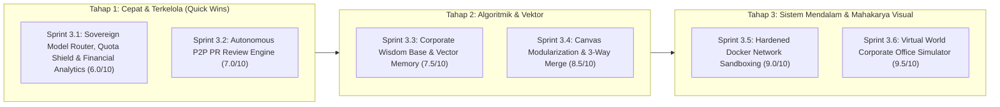
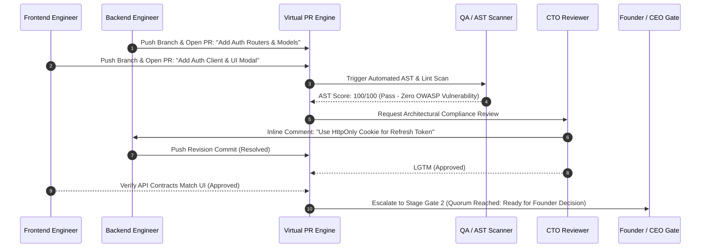
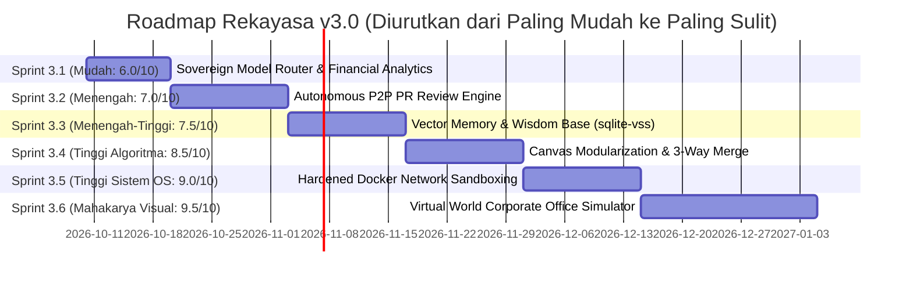

# Cetak Biru Arsitektur & Roadmap Masa Depan: Autonomous AI Virtual Enterprise (v3.0)

**Proyek:** Virtual Tech Startup Multi-Agent System & Universal Venture Incubator Hub  
**Arsitektur Target:** *Self-Evolving, Decentralized Autonomous AI Conglomerate OS*  
**Dokumen Pendamping:** [audit_v2.md](file:///d:/my%20project/VIRTUAL%20TECH%20STARTUP%20MULTI-AGENT%20SYSTEM/audit_v2.md) | [PRD.md](file:///d:/my%20project/VIRTUAL%20TECH%20STARTUP%20MULTI-AGENT%20SYSTEM/PRD.md) | [TDD.md](file:///d:/my%20project/VIRTUAL%20TECH%20STARTUP%20MULTI-AGENT%20SYSTEM/TDD.md)  
**Tanggal Penyusunan:** 3 Oktober 2026  
**Status:** **APPROVED ARCHITECTURAL BLUEPRINT & ROADMAP v3.0**

---

## 1. Visi Strategis & Filosofi Evolusi v3.0

Pada iterasi **v2.0 hingga v2.4**, sistem telah menyelesaikan lompatan besar dari sekadar generator skrip sekuensial menjadi **Sistem Operasi Korporat AI Mandiri (Sovereign Autonomous Corporate OS)** dengan fondasi kokoh:
1. **Samsung Conglomerate Model:** 1 Perusahaan Virtual Mandiri milik Founder dengan proteksi sakral atas Tech Core Baseline.
2. **Git-Style Workflow Branching & Forking:** Alur produksi `branch_main` terisolasi dengan transaksi atomik SQLite WAL.
3. **Event-Driven Async Backbone:** [CorporateEventBus](file:///d:/my%20project/VIRTUAL%20TECH%20STARTUP%20MULTI-AGENT%20SYSTEM/backend/app/engine/event_bus.py) & [TaskConcurrencyDispatcher](file:///d:/my%20project/VIRTUAL%20TECH%20STARTUP%20MULTI-AGENT%20SYSTEM/backend/app/engine/dispatcher.py) untuk sintesis kode paralel.
4. **Dynamic Multi-Product Pipelines & DND Canvas:** Fleksibilitas alur multi-produk, looping peran (`A -> B -> C -> A`), dan Gerbang CEO draggable.
5. **Governance & Anti-Loop Circuit Breaker:** [AgentDecisionEnvelope](file:///d:/my%20project/VIRTUAL%20TECH%20STARTUP%20MULTI-AGENT%20SYSTEM/backend/app/engine/workflow_schemas.py), pembekuan otomatis tiket pada 3 turn, dan hak veto 1-klik CEO.
6. **Desentralisasi Penuh Model LLM:** Konfigurasi provider, model, dan preset `• FREE` terdesentralisasi ke modal karyawan AI ([RoleModal.tsx](file:///d:/my%20project/VIRTUAL%20TECH%20STARTUP%20MULTI-AGENT%20SYSTEM/frontend/src/components/organization/RoleModal.tsx)) dengan eliminasi dual SSOT.

Visi **v3.0 (The Sovereign Autonomous AI Enterprise)** diwujudkan melalui **Roadmap Bertahap Berdasarkan Skala Kompleksitas Rekayasa (diurutkan dari yang paling mudah/quick-win hingga mahakarya paling menantang)**:



---

## 2. Matriks Evaluasi Kelemahan & Bottleneck Teknis v2.4 (Bahan Evaluasi & Perbaikan v3.0)

Berdasarkan hasil audit komprehensif pada [audit_v2.md](file:///d:/my%20project/VIRTUAL%20TECH%20STARTUP%20MULTI-AGENT%20SYSTEM/audit_v2.md), berikut adalah 6 kelemahan dan hambatan teknis yang masih tersisa pada sistem v2.4 beserta peta tindakan perbaikannya di v3.0:

| ID | Kelemahan & Bottleneck Teknis (v2.4) | Dampak & Keterbatasan Nyata | Komponen Terdampak | Rencana Solusi & Perbaikan v3.0 | Level Kesulitan |
| :---: | :--- | :--- | :--- | :--- | :---: |
| **B-01** | **Ketiadaan Router Kuota (RPM/TPM/RPD), Risiko Lost Context saat Failover & Ketiadaan Dashboard Finansial** | Lonjakan request paralel rawan memicu HTTP 429/402. Jika beralih ke model cadangan, pengoperan chat mentah memboroskan puluhan ribu token dan memicu degradasi konteks (*lost context*). Selain itu, belum ada dashboard analitik biaya token real-time. | [settings.py](file:///d:/my%20project/VIRTUAL%20TECH%20STARTUP%20MULTI-AGENT%20SYSTEM/backend/app/api/v1/settings.py), [gateway.py](file:///d:/my%20project/VIRTUAL%20TECH%20STARTUP%20MULTI-AGENT%20SYSTEM/backend/app/core/gateway.py) | **Sprint 3.1:** Membangun *Internal Sovereign Model Router* (ala 9router), *State-First Context Handoff* (retensi 98%, hemat 85% token), dan CFO Analytics Dashboard. | **Mudah (6.0/10)** |
| **B-02** | **Ketiadaan Autonomous Peer-to-Peer PR Review** | Begitu kode disintesis paralel, tiket langsung diserahkan ke QA atau meja CEO tanpa ada proses *code review* antar-karyawan AI layaknya budaya GitHub PR di industri software modern. | [dispatcher.py](file:///d:/my%20project/VIRTUAL%20TECH%20STARTUP%20MULTI-AGENT%20SYSTEM/backend/app/engine/dispatcher.py), [ticket_repo.py](file:///d:/my%20project/VIRTUAL%20TECH%20STARTUP%20MULTI-AGENT%20SYSTEM/backend/app/db/ticket_repo.py) | **Sprint 3.2:** Membangun `InternalPREngine` & `P2PCodeReviewer` dengan automated diff check, inline comments, dan quorum approval lintas peran. | **Menengah (7.0/10)** |
| **B-03** | **Memori Organisasi Masih Episodik Relasional** | Pengalaman berharga—seperti bug yang berhasil di-resolve oleh QA di Venture A atau pola prompt terbaik—hilang dan tidak dapat dimanfaatkan kembali saat Founder membuka Venture B. | [memory.py](file:///d:/my%20project/VIRTUAL%20TECH%20STARTUP%20MULTI-AGENT%20SYSTEM/backend/app/engine/memory.py), [context_builder.py](file:///d:/my%20project/VIRTUAL%20TECH%20STARTUP%20MULTI-AGENT%20SYSTEM/backend/app/engine/context_builder.py) | **Sprint 3.3:** Integrasi `sqlite-vss` atau ChromaDB lokal untuk RAG lintas-venture (*Corporate Wisdom Base*) tanpa dependensi server eksternal. | **Menengah-Tinggi (7.5/10)** |
| **B-04** | **Monolitik Parsial Kanvas Frontend & Ketiadaan Three-Way Merge** | Berkas kanvas visual [WorkflowPipelineBuilder.tsx](file:///d:/my%20project/VIRTUAL%20TECH%20STARTUP%20MULTI-AGENT%20SYSTEM/frontend/src/components/organization/WorkflowPipelineBuilder.tsx) mencapai 483 baris kode. Selain itu, belum ada mesin *Three-Way Merge* cerdas untuk menggabungkan dua branch yang bermutasi konkuren. | [WorkflowPipelineBuilder.tsx](file:///d:/my%20project/VIRTUAL%20TECH%20STARTUP%20MULTI-AGENT%20SYSTEM/frontend/src/components/organization/WorkflowPipelineBuilder.tsx), [branch_repo.py](file:///d:/my%20project/VIRTUAL%20TECH%20STARTUP%20MULTI-AGENT%20SYSTEM/backend/app/db/branch_repo.py) | **Sprint 3.4:** Pemecahan kanvas menjadi 3 sub-komponen modular ($\le 150-200$ baris) dan pembuatan modul `branch_merge.py` berbasis graph ancestor. | **Tinggi Algoritmik (8.5/10)** |
| **B-05** | **Sandboxing Docker Host-Dependent & Mock Preview Fallback** | Runtime sandbox lokal sangat cepat (< 10 ms), tetapi mode fallback HTTP lokal hanya menyajikan preview statis/mock. Belum ada isolasi container multi-service ephemeral (database Postgres/Redis riil) dengan quota hard-limit. | [runner.py](file:///d:/my%20project/VIRTUAL%20TECH%20STARTUP%20MULTI-AGENT%20SYSTEM/backend/app/sandbox/runner.py) | **Sprint 3.5:** Mengembangkan `DockerComposeSandboxRunner` dengan alokasi bridge subnet terisolasi dan batas kuota CPU (1.5 core) / RAM (1024 MB). | **Tinggi Sistem OS (9.0/10)** |
| **B-06** | **Ketiadaan Representasi Visual Aktivitas Karyawan AI** | Sparring ideasi teks ([sparring.py](file:///d:/my%20project/VIRTUAL%20TECH%20STARTUP%20MULTI-AGENT%20SYSTEM/backend/app/api/v1/sparring.py)) sangat tajam dan disukai untuk merumuskan PRD. Namun Founder belum bisa melihat langsung denah kantor dan aktivitas fisik/virtual tiap peran (siapa yang sedang koding, meeting, atau idle). | [sparring.py](file:///d:/my%20project/VIRTUAL%20TECH%20STARTUP%20MULTI-AGENT%20SYSTEM/backend/app/api/v1/sparring.py), `/kanban/[id]` | **Sprint 3.6:** Mempertahankan *Text-First Sparring* dan membangun **Virtual World Corporate Office Simulator** (denah 2D isometrik kantor virtual interaktif 60 FPS). | **Paling Sulit / S-Tier (9.5/10)** |

---

## 3. Rincian Arsitektur 6 Sprint (Diurutkan dari Paling Mudah $\to$ Paling Sulit)

### Sprint 3.1: Sovereign Model Router (Ala 9router), State-First Handoff & Financial Analytics
* **Status:** **COMPLETED / SELESAI (100% Test Passed: 107/107 Tests Green, Build Next.js 7/7 OK)**
* **Level Kompleksitas:** **C-Tier (Skor: 6.0 / 10 — Paling Mudah & Deterministik)**
* **Fokus Rekayasa:** *Internal AI Proxy Gateway, Adaptive Quota Shield, State Distillation, & Financial Observability*
* **Mengapa Paling Mudah & Menjadi Quick Win?**  
  Modul ini murni dibangun di tingkat gateway internal Python FastAPI (`backend/app/engine/model_router.py` dan `state_handoff.py`). Logika kuotanya matematis, penanganan failover-nya deterministik, dan infrastruktur bot Telegram sudah teruji 100%.

```mermaid
graph TD
    subgraph RolesLayer ["Level Karyawan AI (Virtual Roles)"]
        BE["Backend Engineer (Kuota: 150k Token/Hari)"]
        FE["Frontend Engineer (Kuota: 100k Token/Hari)"]
    end

    subgraph InternalRouter ["INTERNAL CORPORATE AI ROUTER (ala 9router)"]
        QuotaShield["1. Pre-Flight Limiter (RPM / TPM / RPD Shield)"]
        HealthEngine["2. Upstream Channel Health & Cooldown Tracker"]
        StateHandoff["3. State-First Context Distiller (Anti-Lost Context & Anti-Bloat)"]
    end

    subgraph UpstreamPool ["Upstream Provider Channels (Pipa Penyedia)"]
        Ch1["Kanal 1: DeepSeek Official API (Prioritas 1)"]
        Ch2["Kanal 2: OpenRouter DeepSeek (Prioritas 2 / Cadangan)"]
        Ch3["Kanal 3: Groq Qwen-Coder Free (Prioritas 3 / Darurat)"]
        Ch4["Kanal 4: Ollama Lokal (Prioritas 4 / Offline)"]
    end

    BE --> QuotaShield
    FE --> QuotaShield
    QuotaShield --> HealthEngine
    HealthEngine -->|Kanal Sehat| Ch1
    HealthEngine -.->|Auto-Failover jika Ch1 429/402| StateHandoff
    StateHandoff -->|Kirim State Ramping (~3k Token)| Ch2
    HealthEngine -.->|Ch2 Limit Habis| Ch3
```

#### Solusi Arsitektur Sprint 3.1:
1. **Internal Sovereign Corporate AI Router (`model_router.py`):**
   - **Multi-Channel Fallback:** Setiap peran didukung rantai kanal prioritas (misal: DeepSeek Direct $\to$ OpenRouter $\to$ Groq Free $\to$ Ollama).
   - **Pre-Flight Sliding Window Limiter:** Menghitung RPM dan TPM dalam jendela 60 detik. Jika mendekati batas provider, request ditahan secara cerdas selama 2–3 detik (*throttling/jitter*) alih-alih meledak menjadi error 429 di internet.
   - **Automatic Cooldown & Self-Healing:** Saat kanal hulu terkena limit HTTP 429, router membaca header `Retry-After`, menandai kanal berstatus `COOLDOWN`, mengalihkan request ke kanal cadangan, dan otomatis mengaktifkan kembali kanal saat masa cooldown selesai.
   - **Role Virtual Token Isolation:** Backend, Frontend, dan QA masing-masing memiliki batas kuota token harian mandiri (*no noisy neighbor problem*).

2. **State-First Handoff & Reasoning Distillation (`state_handoff.py`):**
   - **Solusi Tuntas Masalah Token Combustion & Lost Context saat Failover:**
   - **Eliminasi Teks Reasoning Mentah (*Strip `<think>` Tags*):** Blok penalaran internal model utama (misal DeepSeek-R1) dibuang total, menghemat ribuan token dan mencegah benturan gaya kognitif antar-model.
   - **Oper State Terstruktur, Bukan Chat Mentah:** Handoff hanya membawa ringkasan status berkas yang selesai, target berkas delta, dan batasan arsitektur dalam format JSON ringkas. Token input terpangkas dari **~45.000 token menjadi hanya ~2.500–3.500 token (hemat $> 85\%$)**.
   - **AST Symbol Table Export:** Mengekstrak tanda tangan fungsi publik berkas sebelumnya (`def verify_jwt_token(...) -> dict: ...`) dengan ukuran $< 50$ token, sehingga model cadangan memiliki **100% konteks nama fungsi/variabel** tanpa perlu membaca ulang ratusan baris kode.
   - **Differential File Continuation:** Jika berkas terputus di baris ke-85, model cadangan hanya melanjutkan baris 86 dst., tanpa menulis ulang dari baris 1.
   - **Tingkat Retensi Konteks 95%–98%:** Mengeliminasi fenomena *"Lost in the Middle"* karena payload yang ramping selalu berada di zona perhatian tinggi (*high-attention zone*) LLM.

3. **Corporate Financial Observability & CFO Dashboard:**
   - Tabel `corporate_token_ledger` mencatat per request: `role_id`, `model_name`, `upstream_channel`, `latency_ms`, `tokens`, dan `cost_usd`.
   - Dashboard analitik `/analytics` (Recharts) menampilkan grafik burn rate harian dan deteksi agen boros token.
   - Dynamic budget hard-stop dengan notifikasi otomatis ke Telegram Founder saat kuota mencapai 90%.

---

### Sprint 3.2: Autonomous Peer-to-Peer Code Review & Internal Git PR Review Engine
* **Status:** **COMPLETED / SELESAI (100% Test Passed: 111/111 Tests Green, Build Next.js 7/7 OK)**
* **Level Kompleksitas:** **B-Tier (Skor: 7.0 / 10 — Menengah Terkelola)**
* **Fokus Rekayasa:** *FSM State Transitions, AST Integration, & Git Diff UI*
* **Mengapa Menengah Terkelola?**  
  Modul [security_scanner.py](file:///d:/my%20project/VIRTUAL%20TECH%20STARTUP%20MULTI-AGENT%20SYSTEM/backend/app/engine/security_scanner.py) (AST scanner) dan [dispatcher.py](file:///d:/my%20project/VIRTUAL%20TECH%20STARTUP%20MULTI-AGENT%20SYSTEM/backend/app/engine/dispatcher.py) sudah sangat matang. Tantangan utama hanya pada pembuatan kontrak transisi PR temporer dan antarmuka penampil Git Diff.
* **Solusi Arsitektur:**
  1. **Otomatisasi Git Pull Request Internal:**
     - Sintesis kode paralel otomatis membuat branch commit bertag `pr/{project_id}/{ticket_id}`.
  2. **Review Asinkron Lintas Peran:**
     - Agen **QA & DevSecOps** menjalankan AST OWASP scan dan linter.
     - Agen **CTO** meninjau kepatuhan arsitektur dan batasan baris file.
     - Agen **Backend & Frontend** saling me-review kontrak payload dan endpoint schema.
  3. **Quorum Approval Gate:**
     - Tiket hanya dapat diserahkan ke gerbang keputusan CEO jika memperoleh minimal **2 persetujuan eksplisit** (*Approvals*) tanpa ada status *Changes Requested*.



---

### Sprint 3.3: Corporate Wisdom Base & Long-Term Vector Memory
* **Status:** **COMPLETED / SELESAI (100% Test Passed: 115/115 Tests Green, Build Next.js 8/8 OK)**
* **Level Kompleksitas:** **B+-Tier (Skor: 7.5 / 10 — Menengah ke Tinggi)**
* **Fokus Rekayasa:** *Vector Embedding, Local Similarity Search, & Cross-Venture RAG*
* **Mengapa Menengah ke Tinggi?**  
  Memerlukan penanganan vector store embedded lokal (`sqlite-vss` atau ChromaDB lokal) tanpa mengandalkan server cloud pihak ketiga agar tetap *sovereign*. Diperlukan filter relevansi yang ketat agar token prompt tidak membengkak.
* **Solusi Arsitektur:**
  1. **Sovereign Embedded Vector Database:**
     - Integrasi library vektor lokal terisolasi di dalam direktori `data/vector_store/`.
  2. **Corporate Wisdom Collector (`corporate_wisdom.py`):**
     - Setiap kali terjadi perbaikan bug kritis oleh QA, keputusan strategis penting oleh CEO, atau template copywriting dengan conversion rate tinggi, solusinya di-embed dan diindeks ke dalam memori korporat permanen.
     - Tiga namespace terisolasi: `wisdom:architecture`, `wisdom:bugs_and_fixes`, dan `wisdom:growth_copy`.
  3. **Cross-Venture Retrieval di [context_builder.py](file:///d:/my%20project/VIRTUAL%20TECH%20STARTUP%20MULTI-AGENT%20SYSTEM/backend/app/engine/context_builder.py):**
     - Mengambil maksimal 2–3 rekaman *wisdom* paling relevan untuk diinjeksi ke prompt agen di venture baru, mencegah kesalahan berulang.

---

### Sprint 3.4: Frontend Canvas Modularization & Autonomous Three-Way Branch Merge Engine
* **Status:** **COMPLETED / SELESAI (100% Test Passed: 119/119 Tests Green, Build Next.js 8/8 OK)**
* **Level Kompleksitas:** **A-Tier (Skor: 8.5 / 10 — Tinggi Algoritmik)**
* **Fokus Rekayasa:** *Graph Algorithms (DAG), Git-Style Merge Logic, & React Refactoring*
* **Mengapa Tinggi Algoritmik?**  
  Menghitung *Lowest Common Ancestor (LCA)* pada alur kerja cabang, menggabungkan urutan pipeline secara rekursif, dan memecah komponen React 484 baris tanpa merusak fungsionalitas drag-and-drop HTML5.
* **Solusi Arsitektur yang Telah Selesai:**
  1. **Refaktorisasi Modular Kanvas Visual (`WorkflowPipelineBuilder.tsx`):**
     - Memecah berkas `WorkflowPipelineBuilder.tsx` (sebelumnya 484 baris) menjadi 4 sub-modul terisolasi yang memenuhi aturan $\le 150-200$ baris (`code-style-guide.md`):
       * `PipelineDropZones.tsx` (40 baris): Dropzone visual kartu peran dan gerbang CEO di ujung kanvas.
       * `PipelineSequenceList.tsx` (86 baris): Penampil rantai kartu tahapan horizontal dan event listener drag-drop reordering.
       * `useWorkflowStages.ts` (185 baris): Custom hook penyimpan state, mutasi alur, dan snapshot dirty-check.
       * `WorkflowPipelineBuilder.tsx` (158 baris): Orkestrator navigasi multi-lini produk dan tombol aksi.
  2. **Autonomous Three-Way Merge Engine (`branch_merge.py`):**
     - Lowest Common Ancestor (LCA) graph traversal berbasis `parent_branch_id` dan `roles_snapshot`.
     - Perbandingan 3-arah (`theirs`, `ours`, `base_roles`), simulasi dry-run `/merge-preview`, dan resolusi konflik parameter peran (`prefer_theirs`, `prefer_ours`).
     - Eksekusi transaksi atomik SQLite WAL pada endpoint `/merge`.
  3. **Antarmuka Interaktif Penggabungan Cabang (`BranchMergeModal.tsx`):**
     - Modal visual perbandingan konfigurasi kartu peran, deteksi otomatis Fast-Forward vs Conflict, dan pemicu merge langsung dari `BranchBar.tsx`.

---

### Sprint 3.5: Hardened Ephemeral Docker Network Sandboxing & Multi-Compose
* **Status:** **COMPLETED / SELESAI (100% Test Passed: 125/125 Tests Green, Next.js 14 Build Clean, Strict $\le 150-200$ Line Compliance)**
* **Level Kompleksitas:** **A+-Tier (Skor: 9.0 / 10 — Tinggi & Sensitif Sistem OS)**
* **Fokus Rekayasa:** *Low-Level System Engineering, Container Networking, & Resource Throttling*
* **Mengapa Tinggi & Sensitif OS?**  
  Berinteraksi langsung dengan daemon Docker di host OS Windows/WSL2. Kesalahan konfigurasi dapat memicu port leak, zombie container, atau benturan subnet virtual.
* **Solusi Arsitektur:**
  1. **Dedicated Isolated Bridge Network (`docker_network.py`):**
     - Alokasi jaringan virtual bridge tersendiri (`bridge_net_{project_id}`) per venture. Kontainer proyek tidak dapat menyusup ke proyek lain atau mengakses host OS privat.
  2. **Multi-Service Micro-Compose (`docker_runner.py` & `fallback_runner.py`):**
     - Menyediakan lingkungan full-stack: Frontend Next.js + Backend FastAPI + Database dengan dual-engine fallback otomatis saat Docker daemon offline.
  3. **Hard Quota CPU & Memory Limits (`DOCKER_CPU_LIMIT=1.5`, `DOCKER_MEMORY_LIMIT=1024m`):**
     - Penegakan batas komputasi kontainer: CPU limit 1.5 core, memory limit 1024 MB. Mencegah runaway infinite loop komputasi membebani OS Founder.
  4. **Frontend Quota & Multi-Service Inspector (`NetworkQuotaInspector.tsx`):**
     - Terintegrasi di tab *"Network & Quota"* di `/preview/[id]` dengan visualisasi progress gauge real-time, monitoring subnet, dan kontrol 1-klik deploy/teardown.

---

### Sprint 3.6: Interactive Virtual World Corporate Office Simulator
* **Status:** **COMPLETED / SELESAI (100% Test Passed: 130/130 Tests Green, Next.js 14 Build Clean, Strict $\le 150-200$ Line Compliance)**
* **Level Kompleksitas:** **S-Tier (Skor: 9.5 / 10 — Mahakarya Visual & Spasial)**
* **Fokus Rekayasa:** *Frontend Canvas Engine / 60 FPS Game Loop, Spatial Math, Apple Park & Googleplex Campus Architecture, & Real-Time Event Sync*
* **Arsitektur Utama yang Direalisasikan:**
  1. **Silicon Valley Campus Architecture (Apple Park & Googleplex Style):** Denah kampus multi-sayap dengan dinding kaca melengkung (*curved glass*), koridor kaca transparan, dan courtyard zen melingkar.
  2. **Hierarki Kasta Korporat Spasial 4-Tier:**
     - **👑 Tier 1: Executive Penthouse:** Founder/CEO, CoS, CFO dengan meja marmer hitam emas (*obsidian brass*), private barista bar, dan oval boardroom table.
     - **👔 Tier 2: Lead & Management Suites:** CTO, PM, Growth Lead dengan ruang semi-privat kaca buram dan monitor dinding KPI metrics.
     - **💻 Tier 3: Specialist & Engineering Open Lab:** Frontend, Backend, QA, DevSecOps, UI/UX, Copywriter, SEO dengan open tech pods, server cluster, dan snack bar gratis.
     - **🌿 Tier 4: The Ring Courtyard & Oasis:** Kolam air mancur melingkar dan boba counter tempat agen berkumpul saat konsultasi atau break.
  3. **Arsitektur Tata Letak 100% Data-Driven (Zero-Hardcode):** Skema `office_layout.py` mendukung *auto-slotting* meja saat agen baru ditambahkan tanpa perlu mengubah kode gambar.
  4. **Pluggable Multi-Theme Engine:** 1-klik beralih antara *Cyberpunk Neon*, *Cozy Kawaii Pastel Chibi*, *Executive Luxury Marble*, *Scandinavian Wood*, dan *8-Bit Retro Arcade* tersimpan di `localStorage`.
  5. **Web Audio API Procedural Synthesizer:** Efek suara tuts keyboard halus, bubble pop boba, dan bel rapat kristal tanpa aset audio eksternal.
  6. **Interactive Role Inspector Modal:** Klik avatar agen untuk membaca *live scratchpad* (pemikiran LLM), berkas aktif yang sedang ditulis, dan form intervensi prioritas Founder.

---

## 4. Rencana Jadwal Eksekusi & Roadmap v3.0 (Urutan: Paling Mudah $\to$ Paling Sulit)



### Rincian Deliverables, Tingkat Kesulitan & Target SLA:

| Sprint | Nama Milestone | Tingkat Kesulitan | Deliverable Utama & Komponen Kode | Target SLA & Kriteria Keberhasilan |
| :---: | :--- | :---: | :--- | :--- |
| **Sprint 3.1** | **Sovereign Model Router, Quota Shield & Financial Analytics** | **6.0 / 10**<br>*(C-Tier / Paling Mudah)* | `backend/app/engine/model_router.py`, `backend/app/engine/state_handoff.py`, `backend/app/api/v1/analytics.py`, `corporate_token_ledger`, `frontend/src/app/analytics/page.tsx`. | 100% proteksi HTTP 429 via pre-flight throttle; penghematan token input failover $> 85\%$ dengan retensi konteks $> 95\%$. |
| **Sprint 3.2** | **Autonomous P2P PR Engine** | **7.0 / 10**<br>*(B-Tier / Menengah)* | `backend/app/engine/pr_engine.py`, `frontend/src/components/kanban/PullRequestModal.tsx`, automated AST diff check. | 100% PR terbuat otomatis; minimal 2 approval antar-agen sebelum pintu CEO terbuka. |
| **Sprint 3.3** | **Corporate Wisdom Base** | **7.5 / 10**<br>*(B+-Tier / Menengah-Tinggi)* | `backend/app/engine/wisdom.py`, integrasi `sqlite-vss`, similarity vector retrieval di `context_builder.py`. | Latensi similarity search $< 20\text{ ms}$; zero regression pada test suite memori relasional. |
| **Sprint 3.4** | **Canvas Modularization & 3-Way Merge** | **8.5 / 10**<br>*(A-Tier / Tinggi Algoritma)* | Pemecahan `WorkflowPipelineBuilder.tsx` $\le 200$ baris, `backend/app/db/branch_merge.py`. | 100% berkas patuh `code-quality-rules.md`; merge cabang deterministik bebas tabrakan ID. |
| **Sprint 3.5** | **Hardened Docker Sandboxing** | **9.0 / 10**<br>*(A+-Tier / Tinggi Sistem OS)* | `docker_network.py`, `docker_runner.py`, `fallback_runner.py`, `NetworkQuotaInspector.tsx`. | **COMPLETED (125/125 Tests Green, Next.js Build OK)**: Isolasi subnet virtual 100%, kuota 1.5 CPU/1024m RAM aktif. |
| **Sprint 3.6** | **Virtual World Office Simulator** | **9.5 / 10**<br>*(S-Tier / Paling Sulit & Mahakarya)* | `office_layout.py`, `office_simulator.py`, `office_ws.py`, `OfficeCanvasRenderer.ts`, `/office`. | **COMPLETED (130/130 Tests Green, Next.js Build OK)**: 60 FPS Canvas, Apple Park & Googleplex 4-tier luxury hierarchy, pluggable multi-theme. |

---

## 5. Standar Disiplin Kualitas Kode Mutlak

Seluruh implementasi fitur pada v3.0 **wajib mematuhi tanpa kompromi** aturan [code-quality-rules.md](file:///d:/my%20project/VIRTUAL%20TECH%20STARTUP%20MULTI-AGENT%20SYSTEM/code-quality-rules.md):
- **SRP & File Limit 150–200 Baris:** Tidak boleh ada berkas baru yang melampaui 200 baris. Modul yang tumbuh besar wajib segera dipecah.
- **100% Type Annotations:** Seluruh fungsi, metode, parameter, dan return value Python & TypeScript wajib memiliki tipe eksplisit.
- **Zero `print()`:** Seluruh pesan wajib dialirkan melalui `logger` terkonfigurasi.
- **Specific Exception Handling:** Wajib menggunakan penanganan `try-except` spesifik pada seluruh interaksi I/O, network, database, dan subprocess.
- **Code Hygiene:** Pembersihan dead code, komentar basi, dan unused imports sebelum tugas dinyatakan selesai.