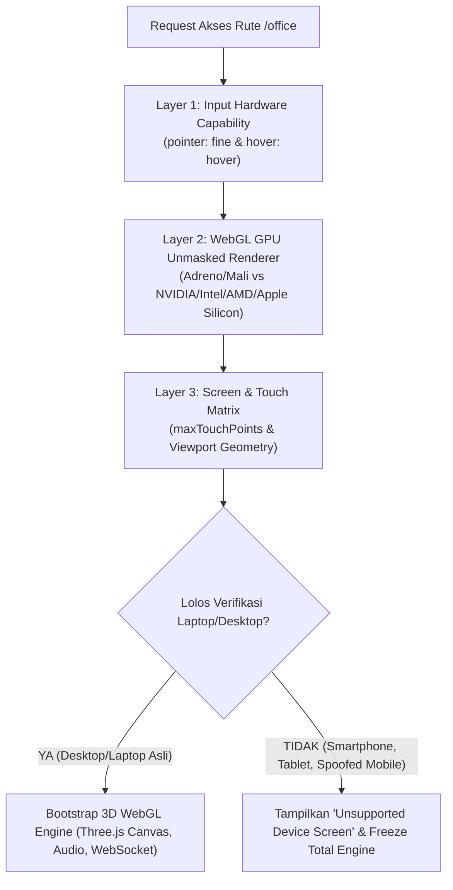

# Master Blueprint: Autonomous Corporate Virtual Office 3D Cyber-Voxel Simulator (v3.0)
**Proyek:** Virtual Tech Startup Multi-Agent System & Universal Venture Incubator Hub  
**Arsitektur Target:** *Event-Driven Asynchronous Sovereign Corporate OS & 3D Cyber-Voxel WebGL Spatial Campus*  
**Engine Grafis:** *Three.js WebGL (60–120 FPS) | Zero External 3D Asset Dependency (100% Procedural Voxels)*  
**Target Hardware:** *Workstation Laptop / Desktop (NVIDIA RTX 3050 + Intel Core i7, 16GB RAM) | Desktop-Only Gated*  
**Dokumen Pendukung:** [future_plan.md](file:///d:/my%20project/VIRTUAL%20TECH%20STARTUP%20MULTI-AGENT%20SYSTEM/future_plan.md) & [audit_final_v1.md](file:///d:/my%20project/VIRTUAL%20TECH%20STARTUP%20MULTI-AGENT%20SYSTEM/audit_final_v1.md)  
**Referensi Benchmark:** `Minecraft Aesthetics`, `Claw3D (claw3d.ai)`, `Oasis (joinoasis.com)`  
**Tanggal Pemutakhiran:** 5 Oktober 2026  
**Status Dokumen:** **APPROVED MASTER BLUEPRINT & EXECUTION PLAN**

---

## 1. Visi Utama: The Sovereign AI Conglomerate 3D Campus

Sistem ini adalah antarmuka spasial 3D interaktif real-time bagi **1 PERUSAHAAN VIRTUAL UTUH (A Real Sovereign AI Conglomerate)** milik Anda:

```
                   ┌────────────────────────────────────────────────────────┐
                   │             CHAIRMAN / FOUNDER / GROUP CEO             │
                   │           (Anda: Pemegang Kendali Tertinggi)           │
                   └──────────────────────────┬─────────────────────────────┘
                                              │
                         Arahan Strategis, First-Person Walk, Chat @Mention, & Stage-Gate Approvals
                                              │
                                              ▼
┌───────────────────────────────────────────────────────────────────────────────────────────────┐
│                       SOVEREIGN AI CONGLOMERATE OPERATING SYSTEM (v3.0)                       │
├────────────────────────────────────────────────┬──────────────────────────────────────────────┤
│               BACKEND CORPORATE OS             │          3D CYBER-VOXEL SPATIAL CAMPUS UI    │
│  • Event-Driven Async Broker (corporate_bus)   │  • Three.js WebGL 60-120 FPS Procedural Voxel│
│  • Dynamic Org & Role Registry (SQLite WAL)    │  • Zero External Asset Dependency (BoxGeom)  │
│  • DAG Concurrency & Worker Task Pool          │  • Dual Cam: Tactical Orbit + First-Person   │
│  • AST OWASP Security Vault & Sandbox          │  • WASD Walk Mode + Mouse Look (Founder View)│
│  • Corporate Wisdom Semantic Memory (vss)      │  • Humanoid Voxel Rigs (Steve/Alex Proportions)│
│  • JWT Secured REST API & Real-Time WebSocket  │  • Multi-Building Triad + 2-Way Elevators    │
│  • Anti-Spoofing Hardware Device Gatekeeper    │  • Oasis @Mention Multi-Agent Command Console│
│  • 3D NavMesh Corridor Collision Bounds        │  • Transparent CLI Terminal & Scratchpad HUD │
└────────────────────────────────────────────────┴──────────────────────────────────────────────┘
```

1. **Chairman / Group CEO (Anda):** Anda menentukan visi strategis, memegang hak veto pada setiap *Stage-Gate Approval*, berinteraksi via konsol `@mention`, serta dapat turun langsung ke lapangan mengendalikan avatar Founder secara *First-Person* (WASD) untuk meninjau pekerjaan agen di meja mereka.
2. **Living 3D Cyber-Voxel Campus:** Ruang kerja 3D bergaya Voxel modern (Minecraft-style proportions) di mana 13 agen AI bekerja secara fisik di workstation mereka, beristirahat di fasilitas lifestyle, naik lift vertikal antar lantai, dan berkumpul tertib di auditorium.

---

## 2. Device Gatekeeper & Anti-Spoofing Hardware Fingerprinting (Desktop-Only Experience)

Untuk menjamin kenyamanan navigasi 3D WebGL, presisi input mouse/keyboard, dan performa tinggi pada workstation Anda, antarmuka **Office HQ dibatasi secara eksklusif hanya untuk perangkat Desktop dan Laptop**. Akses dari smartphone dan tablet diblokir secara absolut, bahkan jika pengguna memaksa masuk melalui URL langsung (`/office`).

### 2.1 Mekanisme Deteksi Anti-Spoofing (Inspirasi PUBG Mobile / Anti-Cheat)
Pemeriksaan `navigator.userAgent` konvensional sangat mudah dipalsukan (*spoofing* via mode *"Request Desktop Site"* di browser HP). Oleh karena itu, diterapkan **4-Lapis Deep Hardware Fingerprinting**:



1. **WebGL Unmasked GPU Renderer (`WEBGL_debug_renderer_info`):**
   * Membaca string kartu grafis perangkat keras langsung dari pipeline driver grafis WebGL:
     * **Mobile Chipset (Ditolak):** `Qualcomm Adreno`, `ARM Mali`, `PowerVR`, `Apple GPU (iPhone/iPad)`.
     * **Desktop Chipset (Diizinkan):** `NVIDIA GeForce / RTX` (misal: *RTX 3050 Laptop GPU* milik Anda), `AMD Radeon`, `Intel Iris / UHD / Arc`, `Apple M1/M2/M3/M4 (macOS)`.
   * *Anti-Bypass:* Jika smartphone mengaktifkan mode *"Desktop Site"*, User-Agent dapat berubah menjadi desktop, namun chipset GPU tetap terbaca `Adreno` atau `Mali`. Sistem mendeteksi anomali ini dan langsung memblokir akses.
2. **Pointer & Hover Media Queries:**
   * Laptop/PC memanfaatkan mouse dan trackpad presisi: `(pointer: fine)` dan `(hover: hover)`.
   * Layar sentuh mobile: `(pointer: coarse)` dan `(hover: none)`.
3. **Touch Points & Screen Resolution Matrix:**
   * Desktop murni: `navigator.maxTouchPoints === 0`.
   * Laptop touchscreen modern: diperbolehkan jika kombinasi GPU berupa desktop GPU dan lebar viewport $\ge 1280\text{px}$.
   * Smartphone/Tablet: touch points $\ge 2$ dengan rasio layar vertikal atau GPU mobile.
4. **Client Hints API (`navigator.userAgentData`):**
   * Membaca platform low-level yang tidak terpengaruh oleh manipulasi header HTTP biasa.

### 2.2 Perilaku Proteksi Antarmuka
1. **Total Engine Freeze pada Rute `/office`:**
   * Jika perangkat terdeteksi sebagai smartphone atau tablet, sistem **TIDAK** menginisialisasi Three.js WebGLRenderer, **TIDAK** membuka WebSocket spasial, dan **TIDAK** memuat buffer audio. Hal ini mencegah konsumsi baterai dan overheating pada perangkat mobile.
   * Sebagai gantinya, layar langsung menampilkan **`UnsupportedDeviceScreen`**: antarmuka dark-mode futuristik dengan grafis laptop/desktop dan panduan:
     > *"Living 3D Virtual Office Campus dirancang secara khusus untuk komputasi workstation presisi tinggi dengan input keyboard & mouse pada resolusi minimal 1280x720. Silakan akses kembali melalui Laptop atau Desktop PC Anda."*
2. **Penyembunyian Tab di Navigasi Mobile:**
   * Seluruh komponen navigasi global (Top Navigation Bar, Drawer Menu) menyembunyikan tab atau tautan menuju `Office HQ` ketika diakses dari smartphone atau tablet melalui utilitas CSS responsif (`hidden lg:flex`) dan hook client-side `useDeviceCapabilities()`.

---

## 3. Arsitektur 3D Cyber-Voxel WebGL: The Minecraft-Style Aesthetic

```
                       ARSITEKTUR 3D CYBER-VOXEL CAMPUS SIMULATOR
                                           │
         ┌─────────────────────────────────┼────────────────────────────────┐
         ▼                                 ▼                                ▼
[100% PROCEDURAL VOXELS]       [HUMANOID VOXEL AGENTS]          [DUAL-MODE CAMERA SYSTEM]
• Zero External 3D File (.gltf)• Steve/Alex Proportions         • Tactical 360° Orbit Drone Cam
• BoxGeometry Meshes murni     • Animasi jalan, ayun tangan,    • First-Person Founder Walk (WASD)
• Translucent Glass Walls        mengetik keyboard, & duduk     • Third-Person Follow Camera
• Emissive Server/Arcade LED   • Setelan jas, hoodie dev, dll   • Zoom in ke layar kerja agen
• AI Generated Wall Art Frames • Speech bubbles 3D di atas kepala• Lift vertikal 3D antar lantai
```

### 3.1 Solusi Masalah Aset: Zero External Asset Dependency (100% Procedural)
Ketiadaan file aset 3D bukanlah kendala, melainkan keunggulan teknis utama:
* **Tidak Ada Unduhan File 3D Berat:** Seluruh dunia 3D dibangun secara prosedural murni menggunakan primitif `THREE.BoxGeometry`, custom canvas textures, dan material PBR. Halaman termuat secara instan (zero latency download).
* **Lantai & Dinding Voxel:**
  * Parket kayu oak gelap untuk ruang eksekutif, marmer slate untuk lobi, dan grid raised-floor berlampu untuk ruang server.
  * Dinding pembatas kaca tembus pandang (*translucent tinted glass*) berbingkai logam matte.
* **Furnitur Voxel Hidup:**
  * Meja kerja kayu solid dengan kaki penyangga voxel.
  * Dual-monitor melengkung dengan material berpendar (*emissive glow*) menampilkan baris kode berjalan.
  * Server rack hitam tinggi dengan barisan lampu LED berkedip hijau/cyan.
  * Kabinet arcade neon, meja ping-pong dengan net voxel, kapsul tidur (*nap pods*), dan kolam koi zen dengan air jernih dinamis.
* **Dekorasi Dinding Berpigura (AI Art Gallery):**
  * Dinding kantor didekorasi dengan pigura kanvas 3D yang memuat lukisan-lukisan hasil generated image AI bertema arsitektur tech, logo corporate, dan blueprint sistem.

### 3.2 Karakter Agen Voxel Humanoid (Procedural Rigging)
Setiap agen AI dirender sebagai entitas voxel 3D hierarkis dengan proporsi Steve/Alex:
* **Hierarki Bodi:** `Head` (bisa menoleh ke arah kamera atau pembicara), `Torso` (pakaian khas role: jas eksekutif untuk Founder/CoS/CFO, hoodie tech untuk FE/BE/DevSecOps), `Left/Right Arm`, dan `Left/Right Leg`.
* **State Machine Animasi 3D:**
  * `IDLE`: Nafas halus (pergeseran mikro sumbu Y) dan kepala sesekali menoleh.
  * `WALKING`: Siklus ayunan tangan dan kaki bergantian secara matematis (sine wave interpolation).
  * `CODING`: Duduk di kursi voxel, kedua tangan mengayun mengetik di atas keyboard meja kerja dengan pantulan cahaya layar ke wajah.
  * `MEETING`: Duduk tertib di barisan kursi auditorium menghadap podium atau meja rapat oval.
  * `RECREATION`: Berdiri di depan arcade machine, memegang gitar/keyboard di studio musik, santai di dalam capsule nap pod, atau duduk di tepi kolam koi.

---

## 4. Master Plan Mega-Campus Triad & Fasilitas Lifestyle

Lingkungan kerja virtual dibagi menjadi 3 kompleks gedung tematik terintegrasi (skala Silicon Valley Campus) agar agen tidak terasa terkekang dalam 1 kubikel sempit:

```
                  ┌────────────────────────────────────────────────────────┐
                  │          VIRTUAL TECH MEGA-CAMPUS MASTER PLAN          │
                  └──────────────────────────┬─────────────────────────────┘
                                             │
         ┌───────────────────────────────────┼───────────────────────────────────┐
         ▼                                   ▼                                   ▼
┌─────────────────────────┐       ┌─────────────────────────┐       ┌─────────────────────────┐
│   GEDUNG 1: APOLLO      │       │   GEDUNG 2: DA VINCI    │       │   GEDUNG 3: OLYMPUS     │
│   (Engineering Core     │◄═════►│   (Creative Commons     │◄═════►│   (Executive & Zen      │
│     & Playground)       │       │    & Lifestyle Hub)     │       │       Pavilion)         │
├─────────────────────────┤       ├─────────────────────────┤       ├─────────────────────────┤
│ Fl 3: Retro Arcade,     │       │ Fl 3: Soundproof Music  │       │ Fl 3: Founder's Sanctum │
│       Ping-Pong, VR Lab │ (Jembatan│       Studio & Capsule   │ (Jembatan│       Penthouse, Zen    │
│ Fl 2: SecOps Vault &    │  Kaca │       Nap Sanctuary     │  Kaca │       Garden & Koi Pond │
│       Docker Sandbox    │Skybridge│ Fl 2: Media Studio,    │Skybridge│ Fl 2: Strategic Board-  │
│ Fl 1: Silicon Lab &     │  Fl 2)│       Copywriting Pod   │  Fl 2)│       room & Sparring   │
│       Auditorium        │       │ Fl 1: Gourmet Food Hall │       │ Fl 1: Innovation Hub &  │
│       All-Hands         │       │       & Barista Cafe    │       │       Reception Lounge  │
└─────────────────────────┘       └─────────────────────────┘       └─────────────────────────┘
         ▲                                   ▲                                   ▲
         └───────────────────────────────────┴───────────────────────────────────┘
               Koneksi Bawah: Green Promenade (Taman Terbuka & Jalur Pedestrian)
```

### 4.1 Rincian 3 Gedung Tematik
1. **Gedung 1: Apollo Hall (Engineering Core & Retro Playground):**
   * **Lantai 1:** *Silicon Lab* (Workstation pod Frontend, Backend, QA) dan *Executive Briefing Auditorium* (Panggung presentasi & All-Hands Meeting).
   * **Lantai 2:** *SecOps Vault & Datacenter* (Rak server dengan lampu LED bilyar, Docker network isolation runtime).
   * **Lantai 3:** **The Retro Arcade & Gaming Zone** — Area rekreasi bebas stres berisi mesin arcade klasik berlayar neon, meja ping-pong dengan animasi bola memantul, dan beanbag lounge untuk rehat sehabis coding.
2. **Gedung 2: Da Vinci Hub (Creative Commons, Music & Lifestyle Sanctuary):**
   * **Lantai 1:** **Gourmet Food Hall & Artisan Cafe** — Kantin modern lengkap dengan counter ramen hangat, bar boba tea, mesin espresso beruap, dan meja makan komunal tempat para agen duduk makan bersama.
   * **Lantai 2:** *Creative & Media Pod* — Ruang kerja UI/UX Designer, Copywriter, dan bilik Podcast/Streaming media.
   * **Lantai 3:** **Soundproof Music Jam Studio & Capsule Nap Sanctuary** —
     - *Music Studio:* Dilengkapi gitar listrik voxel, synthesizer keyboard dengan tuts bercahaya, dan busa akustik hexagonal tempat agen bermain musik dengan partikel notasi balok $\unicode{x266a} \ \unicode{x266b}$ melayang.
     - *Capsule Nap Sanctuary:* Pod kapsul tidur futuristik elips dengan kubah kaca berdenyut biru lembut (`zzz`), tempat agen mengisi ulang stamina fokus mental.
3. **Gedung 3: Olympus Pavilion (Executive C-Suite Suites, Strategy & Zen Wellness):**
   * **Lantai 1: Innovation Showroom & Investor Reception Lounge:**
     - Galeri pameran interaktif produk-produk SaaS, e-book, dan aset digital yang telah berhasil diproduksi perusahaan.
     - Lounge tamu dan calon investor dengan meja kaca marmer dan layar katalog portofolio venture.
   * **Lantai 2: The C-Suite Executive Wing & Strategic Boardroom:**
     - **Ruangan CFO (Capital & Treasury Office):** Meja mahoni gelap dengan layar telemetri keuangan (grafik *Cash Burn Rate*, alokasi kuota token LLM, dan proyeksi valuasi bisnis).
     - **Ruangan CTO (Strategic Architecture Suite):** Kantor pribadi CTO dengan papan diagram arsitektur blueprint sistem dan radar latensi AI.
     - **Ruangan CPO / PM Lead (Product Strategy Office):** Ruang kerja pimpinan produk dengan roadmap linimasa venture, kanban backlog master, dan papan PRD.
     - **Strategic Boardroom (Meja Rapat Oval 10 Kursi):** Meja rapat kayu walnut oval di tengah lantai dengan 10 kursi eksekutif dan proyektor presentasi.
   * **Lantai 3: Founder's Sanctum, CoS Office & Rooftop Zen Garden (Executive Penthouse):**
     - **Founder's Private Sanctum (Meja Kerja Utama Anda):** Meja kayu oak hitam megah dengan 3 monitor panoramic melengkung, karpet navy berlis emas, dan pemandangan luas ke seluruh kampus.
     - **Ruangan Chief of Staff (CoS Executive Gatekeeper):** Terletak tepat di sebelah ruangan Founder sebagai penyaring dan orkestrator instruksi Founder. Dilengkapi matriks delegasi dan layar sentral pemantau aktivitas 3 gedung.
     - **Rooftop Biophilic Zen Garden & Koi Pond:** Terhubung langsung dengan teras luar ruangan Founder: taman asri dengan pohon sakura mini, jembatan lengkung kayu, dan kolam ikan Koi dengan riak air animasi serta ikan koi voxel berenang aktif.

### 4.2 Infrastruktur Konektivitas: Jembatan Kaca & Green Promenade
1. **The Glass Skybridge (Jembatan Kaca Layang Lantai 2):** Menghubungkan Apollo Hall $\longleftrightarrow$ Da Vinci Hub $\longleftrightarrow$ Olympus Pavilion di lantai 2. Agen dapat menyeberang antargedung sambil melihat taman kampus di bawahnya.
2. **The Green Promenade (Lantai 1 Dasar):** Jalur pedestrian asri berpepohonan yang menghubungkan pintu masuk lantai dasar ketiga gedung.

---

## 5. Sistem Navigasi Kamera & First-Person Founder Walk Mode

Pengguna memiliki kebebasan navigasi tingkat tinggi antara pengawasan makro dan interaksi mikro:

```
                       PILIHAN MODE KAMERA SPASIAL
                                    │
       ┌────────────────────────────┴───────────────────────────┐
       ▼                                                        ▼
[MODE 1: TACTICAL ORBIT CAM]                         [MODE 2: FIRST-PERSON FOUNDER CAM]
• Pandangan arsitektur 3D miring                     • Klik karakter Founder / Tekan [F]
• Putar kamera 360°, Zoom in/out                     • Kamera masuk ke sudut pandang mata Anda
• Klik agen untuk buka terminal/log                  • Jalan keliling kantor pakai WASD + Mouse Look
• Pantau 3 gedung sekaligus                          • Naik lift, sapa agen langsung di mejanya!
```

1. **Mode 1: Tactical Orbit / God-Mode Cam (Default):**
   * Kamera melayang di atas kompleks 3 gedung dengan sudut miring dinamis.
   * Kontrol mouse: Klik kiri seret untuk memutar 360°, klik kanan untuk pan menggeser peta, scroll roda mouse untuk zoom in/out hingga ke meja kerja agen.
   * Klik agen mana pun untuk memfokuskan kamera dan membuka *Agent Terminal Drawer HUD*.
2. **Mode 2: First-Person Founder Walk Mode (WASD + Mouse Look):**
   * Dipicu dengan menekan avatar Founder di ruang kerja atau menekan tombol pintasan keyboard `[F]`.
   * Kamera terkunci langsung ke mata karakter Founder (tinggi $Y = 1.7\text{m}$).
   * **Kontrol Workstation:**
     * `W`, `A`, `S`, `D`: Berjalan maju, mundur, strafe kiri/kanan.
     * `Shift`: Berlari cepat (*sprint*).
     * `Spasi`: Melompat / menaiki anak tangga kecil.
     * `Mouse Look`: Mengarahkan pandangan kepala secara bebas (*Pointer Lock API*).
   * **Interaktivitas Dunia Nyata:**
     * Founder dapat berjalan masuk ke dalam lift, memilih tombol lantai tujuan, melangkah ke kubikel agen untuk menyapa mereka, masuk ke ruang santai arcade, atau menikmati ketenangan di Kolam Koi Olympus.
     * Menekan tombol `[ESC]` mengembalikan tampilan ke *Tactical Orbit Cam*.
3. **Mode 3: Third-Person Follow Cam:**
   * Kamera mengambang di belakang bahu kanan Founder ($2\text{m}$ di belakang, $1.5\text{m}$ di atas) dengan pergerakan halus (*lerp camera damping*).

---

## 6. Infrastruktur Transportasi & Pathfinding Bebas Tabrakan

### 6.1 Sistem Lift Universal Dua Arah (Universal 2-Way Elevator)
Lift di kampus virtual adalah **infrastruktur transportasi vertikal bebas dua arah** yang digunakan secara aktif oleh seluruh agen:
* Menghubungkan Lantai 1 $\longleftrightarrow$ Lantai 2 $\longleftrightarrow$ Lantai 3 di masing-masing gedung.
* Agen menaiki lift secara mandiri untuk berpindah aktivitas (misal dari Silicon Lab Fl 1 ke Arcade Fl 3, atau dari C-Suite Fl 2 ke Zen Garden Fl 3).
* Saat Founder berada dalam mode *First-Person*, Founder cukup melangkah masuk ke kubus lift dan menekan tombol lantai tujuan.

### 6.2 Sistem 3D NavMesh Bebas Tabrakan (Anti-Tembus Dinding Kaca)
* Seluruh dinding kaca, partisi ruangan, dan furnitur solid memiliki *bounding box* tabrakan 3D.
* Agen berjalan mengikuti graf jalur koridor (*corridor waypoints*) tanpa pernah menembus kaca atau melangkahi meja kerja.

### 6.3 Formula Kursi Rapat Berbasis Induk (Zero Hallway Overflow)
Kalkulasi posisi kursi dihitung secara matematis relatif terhadap posisi panggung atau meja rapat:
* **Auditorium Apollo (All-Hands):** Formasi 13 kursi baris rapi menghadap panggung podium. Saat tombol *All-Hands* ditekan, seluruh 12 agen berjalan masuk tertib ke kursi masing-masing tanpa ada yang menumpuk di lorong.
* **Boardroom Olympus:** Formasi 10 kursi oval simetris mengitari meja walnut.

---

## 7. Interaksi Spasial & Backend Sovereign Corporate OS

1. **Oasis `@mention` Multi-Agent Chat Console:**
   * Konsol obrolan dock bawah dengan popover autocomplete saat mengetik `@`.
   * Menghubungkan mention `@all` atau multi-mention (`@fe @be`) ke pergerakan agen di kanvas 3D dan speech bubble visual.
2. **Autonomous Demo Story Engine & Flying Document Handoff:**
   * Siklus hidup startup 5-babak (Standup $\to$ Coding $\to$ Coffee Break $\to$ QA Audit $\to$ CEO Approval).
   * Animasi dokumen tugas terbang melayang di udara saat serah-terima tiket antar meja kerja agen.
3. **Transparent CLI Terminal Drawer HUD:**
   * Panel samping kaca slide-out saat karakter agen diklik, menampilkan log terminal eksekusi, AST audit, dan scratchpad tugas nyata (*Honest Signals*).
4. **No-Code Campus Architect Modal:**
   * Modal visual untuk menambah ruangan/gedung baru tanpa koding, tersimpan di database SQLite dan di-hot-reload ke scene 3D secara instan.

---

## 8. Struktur Berkas & Kepatuhan Arsitektur (`code-style-guide.md`)

Seluruh berkas mematuhi batas ketat **maksimal 150–200 baris kode per file** dengan pemisahan Single Responsibility Principle:

```
frontend/src/
├── hooks/
│   └── useDeviceCapabilities.ts       # Deteksi WebGL GPU, pointer, touch points (≤ 120 baris)
├── components/office/
│   ├── UnsupportedDeviceScreen.tsx    # Layar blokir Desktop Only premium (≤ 110 baris)
│   ├── DeviceGatekeeper.tsx           # HOC guard pembungkus rute /office (≤ 100 baris)
│   ├── CampusArchitectModal.tsx       # Modal visual No-Code tambah ruangan (≤ 175 baris)
│   ├── OfficeControlBar.tsx           # Bar kontrol tab gedung, lantai, kamera (≤ 150 baris)
│   ├── OfficeChatConsole.tsx          # Oasis @mention console dengan autocomplete (≤ 150 baris)
│   ├── AgentRosterSidebar.tsx         # Sidebar daftar agen & status (≤ 150 baris)
│   ├── AgentTerminalDrawer.tsx        # HUD log terminal eksekusi agen (≤ 80 baris)
│   ├── useOfficeSimulation.ts         # Hook state orchestrator spasial & WebSocket (≤ 180 baris)
│   └── 3d/
│       ├── Office3DSceneManager.ts    # Setup Three.js WebGLRenderer, Scene, Lights (≤ 180 baris)
│       ├── OfficeVoxelBuilder.ts      # Generator prosedural lantai & dinding kaca (≤ 190 baris)
│       ├── OfficeVoxelFurniture.ts    # Generator meja, dual-monitor, server racks (≤ 190 baris)
│       ├── OfficeVoxelLeisure.ts      # Generator arcade, pingpong, nap pod, kolam koi (≤ 170 baris)
│       ├── OfficeVoxelCharacter.ts    # Rigging humanoid voxel Steve/Alex & animasi (≤ 190 baris)
│       ├── OfficeCameraController.ts  # OrbitControls & PointerLock WASD First-Person (≤ 180 baris)
│       └── Office3DCanvas.tsx         # Komponen canvas Three.js Next.js (≤ 160 baris)

backend/app/
├── core/office_models.py              # Pydantic schemas spasial, ruangan & chat (≤ 120 baris)
├── core/office_simulator.py           # State engine spasial backend & pergerakan agen (≤ 170 baris)
├── core/office_layout_config.py       # Loader & persistensi database ruangan dinamis (≤ 120 baris)
└── api/v1/endpoints/office.py         # Endpoint REST & WebSocket terotentikasi (≤ 160 baris)
```

---

## 9. Kriteria Keberhasilan Akhir (Acceptance Criteria)

1. **Zero External 3D Asset Dependency:** Seluruh dunia kantor 3D dibangun 100% dari primitif voxel prosedural (`THREE.BoxGeometry`) tanpa perlu mengunduh file `.gltf`/`.obj`.
2. **Desktop-Only Anti-Spoofing Gating:** Akses dari HP/Tablet langsung diblokir total dengan `UnsupportedDeviceScreen`, GPU mobile dideteksi via WebGL unmasking, dan tab Office HQ disembunyikan di navigasi mobile.
3. **Dual-Mode Camera Experience:** Pengguna dapat berpindah mulus antara *Tactical 360° Orbit Drone Cam* dan *First-Person Founder Walk Mode* menggunakan tombol `W, A, S, D` + mouse look.
4. **Living Humanoid Voxel Characters:** 12 agen AI bergerak dengan hierarki bodi voxel (kepala, badan, tangan berayun/mengetik, kaki melangkah) dengan setelan pakaian khas role masing-masing.
5. **Tertib All-Hands (Zero Overflow):** Tombol All-Hands mengarahkan seluruh agen duduk dengan rapi di kursi Auditorium Apollo tanpa ada yang tercecer di koridor.
6. **Universal 2-Way Elevators:** Agen dan Founder dapat naik-turun lift antar Lantai 1, 2, dan 3 di seluruh kompleks gedung.
7. **Fasilitas Lifestyle Lengkap:** Menampilkan Arcade neon, Studio Musik berpartikel not balok, Capsule Nap Pods yang berdenyut, Food Hall beruap, dan Kolam Koi Zen dengan ikan berenang.
8. **Bebas Error 401 Unauthorized:** Seluruh polling state dan eksekusi demo berjalan terotentikasi tanpa error.
9. **Kepatuhan Aturan Kode:** Seluruh file baru mematuhi batas ketat $\le 150-200$ baris, type hints lengkap, zero `print()`, dan logging terstruktur.
